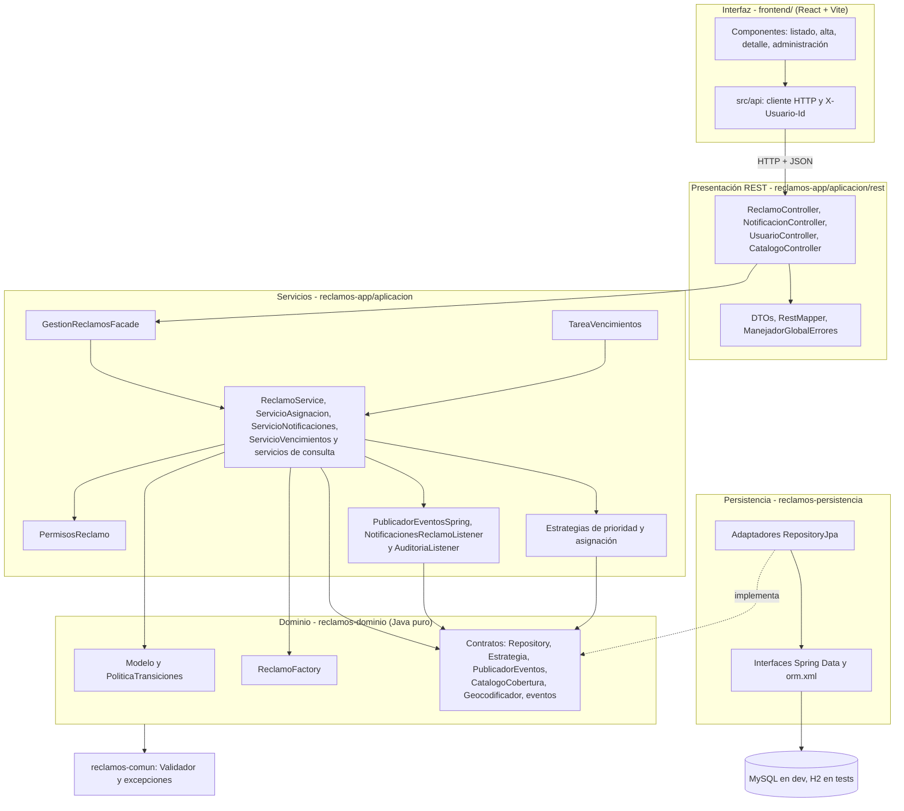
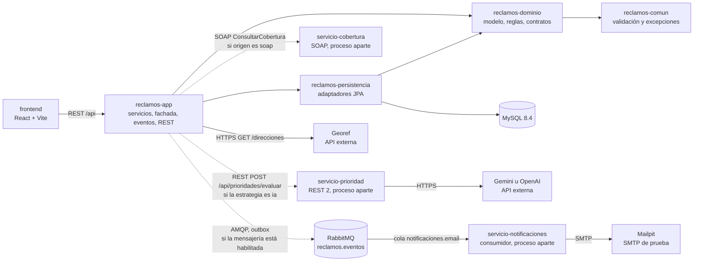
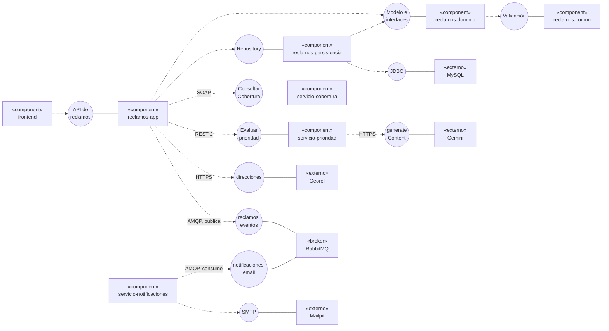
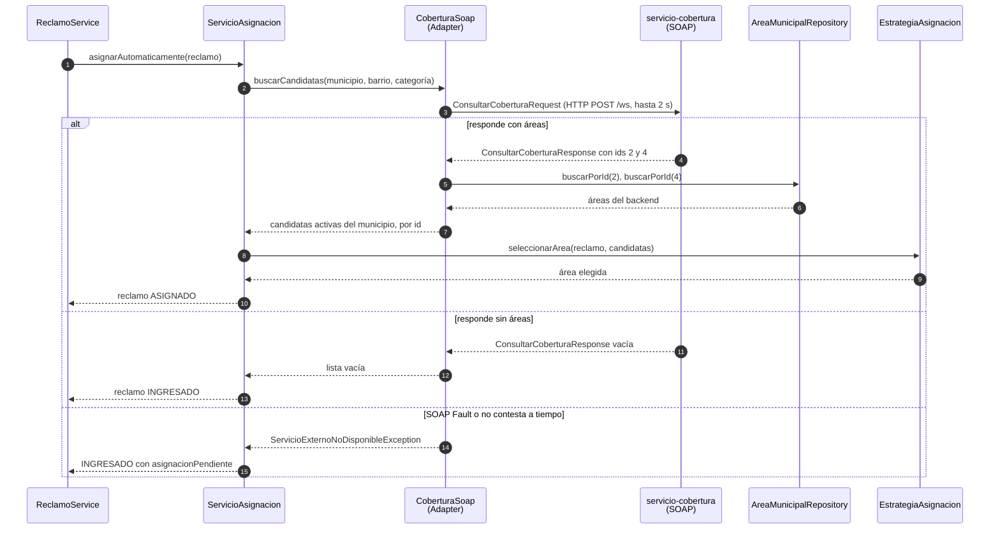
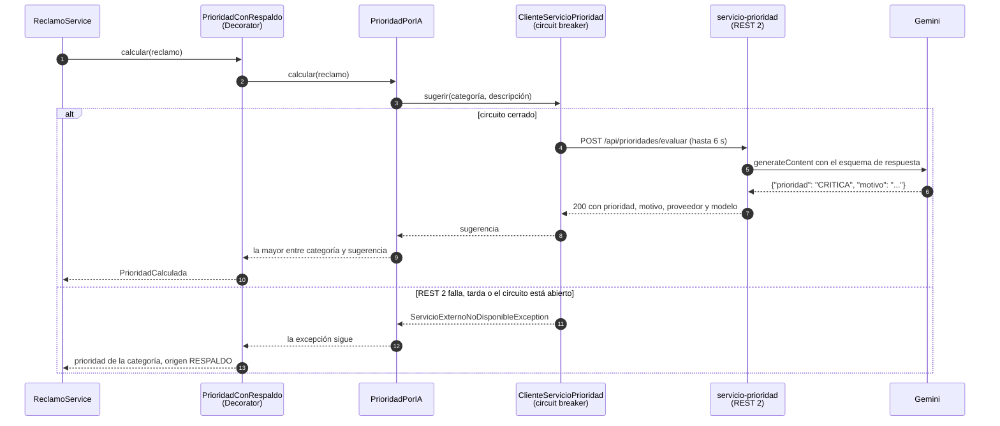
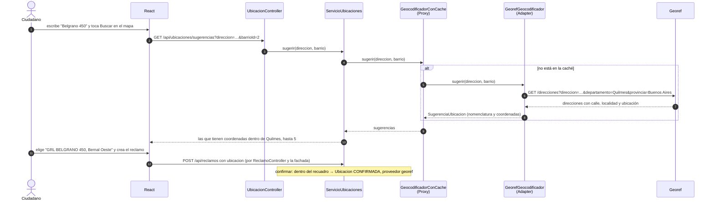
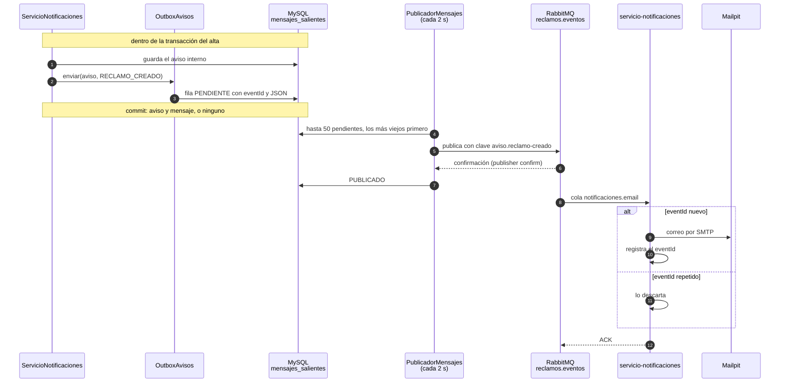

# Arquitectura

El sistema es una aplicación en capas: la interfaz llama a la API REST, la API a los servicios y los
servicios al dominio. El dominio no depende de ningún framework: define interfaces (Repository,
estrategias, integraciones) y las capas de afuera las implementan.

## Capas



El recorrido de una operación es siempre el mismo:

```text
React → Controller → Facade → Servicios → Dominio → Repository → JPA → MySQL
```

| Capa | Dónde está | Responsabilidad | No hace |
| --- | --- | --- | --- |
| Interfaz | `frontend/` | Mostrar reclamos y enviar acciones del usuario | No decide permisos: muestra las `accionesDisponibles` que calcula el backend |
| Presentación REST | `reclamos-app/.../aplicacion/rest` | Traducir HTTP y JSON a llamadas de la fachada; uniformar errores | No tiene lógica de negocio |
| Servicios | `reclamos-app/.../aplicacion` | Coordinar cada caso de uso dentro de una transacción | No conoce HTTP ni JPA |
| Dominio | `reclamos-dominio` | Reglas del negocio, creación del reclamo, contratos | No depende de Spring ni de JPA |
| Persistencia | `reclamos-persistencia` | Implementar los Repository con Spring Data JPA | No tiene reglas de negocio |
| Utilidades | `reclamos-comun` | Validación y excepciones compartidas | No depende de nada |

El detalle de las clases del dominio y de las tablas está en [modelo-dominio.md](modelo-dominio.md).

## Componentes

Cada módulo Maven es un componente con artefacto propio. Las dependencias van en un solo sentido.



`servicio-cobertura`, `servicio-prioridad` y `servicio-notificaciones` no son módulos del backend: son otras
aplicaciones, en `servicios/`, que se compilan, se prueban y se despliegan por separado. Lo único que
comparten con el backend son sus contratos: [`cobertura.xsd`](contratos/soap/cobertura.xsd),
[el OpenAPI de REST 2](contratos/README.md#rest-2-post-apiprioridadesevaluar) y
[el contrato de mensajes](contratos/mensajes.md).

## Componentes e interfaces

El diagrama anterior muestra quién depende de quién. Este muestra **por qué interfaz** se comunican, en la
notación de UML: cada círculo es una interfaz; la línea continua sale del componente que la **provee** y la
flecha punteada, del que la **requiere**. Ningún componente conoce la implementación de otro: solo su interfaz.



| Componente | Provee | Requiere | Contrato |
| --- | --- | --- | --- |
| `frontend` | Interfaz web | API de reclamos | [`api-contract.md`](api-contract.md) y `openapi/reclamos.yaml` |
| `reclamos-app` | API de reclamos (REST 1) | Repository, `ConsultarCobertura`, evaluar prioridad, Georef, exchange `reclamos.eventos` | OpenAPI de REST 1 |
| `reclamos-dominio` | Modelo e interfaces: Repository, `EstrategiaPrioridad`, `EstrategiaAsignacion`, `CatalogoCobertura`, `Geocodificador`, `PublicadorEventos` | Validación de `reclamos-comun` | Las interfaces Java del paquete `dominio` |
| `reclamos-persistencia` | Implementación de los Repository | JDBC (MySQL) | `orm.xml` |
| `reclamos-comun` | Validación y excepciones | — | — |
| `servicio-cobertura` | `ConsultarCobertura` (SOAP) | Su catálogo, en un archivo propio | [`cobertura.xsd`](contratos/soap/cobertura.xsd) y el WSDL |
| `servicio-prioridad` | `POST /api/prioridades/evaluar` (REST 2) | API de Gemini (u OpenAI) | `openapi/prioridad.yaml` |
| `servicio-notificaciones` | Nada: solo consume | Cola `notificaciones.email`, SMTP | [`mensajes.md`](contratos/mensajes.md) |

Dentro del backend pasa lo mismo, con interfaces Java. Es la **transparencia de ubicación** de la Clase 1: el
servicio que usa la interfaz no sabe si la respuesta sale de la base, de otro proceso o de una API externa.

| Interfaz | La usa | Implementaciones | Se elige con |
| --- | --- | --- | --- |
| `CatalogoCobertura` | `ServicioAsignacion` | `CoberturaLocal` (base) o `CoberturaSoap` (servicio SOAP) | `reclamos.cobertura.origen` |
| `EstrategiaPrioridad` | `ReclamoService` | `PrioridadPorCategoria`, `PrioridadPorPalabrasClave` o `PrioridadConRespaldo` sobre `PrioridadPorIA` (REST 2) | `reclamos.prioridad.estrategia` |
| `Geocodificador` | `ServicioUbicaciones` | `GeocodificadorConCache` sobre `GeorefGeocodificador` | — |
| `SalidaDeAvisos` | `ServicioNotificaciones` | Ninguna salida, u `OutboxAvisos` (RabbitMQ) | `reclamos.mensajeria.habilitada` |
| `BrokerMensajes` | `PublicadorMensajes` | `BrokerRabbit` | — |

## Servicios orientados a componentes

Cada servicio tiene una responsabilidad y se puede probar por separado.

| Servicio | Responsabilidad |
| --- | --- |
| `ReclamoService` | Casos de uso de escritura: crear, asignar, reasignar y cambiar de estado |
| `ServicioAsignacion` | Decidir qué área atiende un reclamo: automática con la estrategia activa, o manual |
| `ServicioNotificaciones` | Decidir a quién se avisa en cada evento y guardar los avisos |
| `ServicioVencimientos` | Marcar los reclamos que pasaron su fecha límite y publicar `ReclamoVencido` |
| `ConsultaReclamosService` | Listar según el rol, buscar por número, avisos y acciones disponibles |
| `ConsultaCatalogosService` | Usuarios, categorías, barrios y áreas |

`PermisosReclamo` no es un servicio de negocio: es el componente que los servicios consultan para saber
quién puede crear y quién puede ver cada reclamo.

Los servicios se integran entre sí de dos formas:

- **Por interfaces.** Dependen de los contratos del dominio (`ReclamoRepository`,
  `EstrategiaPrioridad`, `EstrategiaAsignacion`, `PublicadorEventos`, `CatalogoCobertura`) y Spring
  inyecta la implementación.
- **Por eventos de dominio.** `ReclamoService` y `ServicioVencimientos` publican `ReclamoCreado`,
  `ReclamoAsignado`, `EstadoReclamoCambiado`, `ReclamoResuelto` y `ReclamoVencido`. Dos listeners
  reaccionan sin que quien publica los conozca: `NotificacionesReclamoListener` genera los avisos
  y `AuditoriaListener` registra cada evento.

`TareaVencimientos` ejecuta `ServicioVencimientos` cada minuto. El intervalo se cambia con
`reclamos.vencimientos.intervalo-ms` y la tarea se apaga con `reclamos.vencimientos.habilitado: false`.
Toda la configuración `reclamos.*` está tipada en `PropiedadesReclamos`: una clave mal escrita o un
intervalo que no sea positivo impiden el arranque, en lugar de quedar ignorados.

## Decisiones de diseño

| Decisión | Motivo |
| --- | --- |
| Mapeo JPA en `META-INF/orm.xml` en lugar de anotaciones | El dominio queda sin ninguna dependencia de JPA y se prueba con JUnit solo |
| Interfaces Repository en el dominio, adaptadores en persistencia | Los servicios no dependen de `JpaRepository`; en los tests se reemplazan por dobles en memoria |
| Transiciones en una tabla (`PoliticaTransiciones`) y no con el patrón State | Nueve transiciones se leen mejor en una tabla que repartidas en siete clases |
| Identidad con el encabezado `X-Usuario-Id` | El Hito 1 no pide autenticación; el rol sale del usuario guardado en la base |
| Los avisos se generan dentro de la transacción | Si el listener de avisos falla se revierte todo el caso de uso; no quedan reclamos sin aviso |
| La auditoría corre después del commit | Solo registra hechos confirmados; una operación revertida no deja rastro falso |
| El frontend llama a `/api` en su mismo origen y un proxy reenvía al backend | No hace falta configurar CORS en Spring; funciona igual con Vite y con nginx |
| `accionesDisponibles` en la respuesta del reclamo | La interfaz no repite las reglas de transición: muestra un botón por cada acción |
| `open-in-view: false` y DTOs en REST | No se serializan entidades JPA ni se abren consultas durante la respuesta HTTP |
| Bloqueo optimista con `@Version` en `Reclamo` | Dos operaciones simultáneas sobre el mismo reclamo no se pisan: la segunda recibe `409 CONFLICTO_CONCURRENTE` |
| OpenAPI generado del código con springdoc | El contrato de Swagger no se desactualiza: `OpenApiTest` lo regenera en `docs/openapi/reclamos.yaml` |

## Integraciones de la Segunda Parte

El PR 8 dejó listos los puntos de entrada y cada integración llega en su PR. Los contratos están en
[`contratos/`](contratos/README.md).

| Integración | Dónde entra | Estado | Qué se agrega |
| --- | --- | --- | --- |
| Prioridad con IA (REST 2) | `EstrategiaPrioridad`, que devuelve `PrioridadCalculada` | **Hecho (PR 10)**: `PrioridadPorIA`, `PrioridadConRespaldo` y `servicio-prioridad`; ver abajo | — |
| Cobertura por SOAP | `CatalogoCobertura`, que usa `ServicioAsignacion` | **Hecho (PR 9)**: `CoberturaSoap` y `servicio-cobertura`; ver abajo | — |
| Geocodificación (API externa) | `Geocodificador` | **Hecho (PR 11)**: `GeorefGeocodificador`, `GeocodificadorConCache` y `ServicioUbicaciones`; ver abajo | — |
| Mensajería | `ServicioNotificaciones` | **Hecho (PR 12)**: outbox, `PublicadorMensajes`, RabbitMQ y `servicio-notificaciones`; ver abajo | — |

`EstrategiaAsignacion` no cambia: sigue eligiendo entre las candidatas, que ahora entrega
`CatalogoCobertura` en lugar del Repository.

### Cobertura por SOAP

Con `reclamos.cobertura.origen: soap`, `ServicioAsignacion` recibe `CoberturaSoap` en lugar de
`CoberturaLocal`. No cambia nada más: la interfaz es la misma, y `ServicioAsignacion` no sabe si las
candidatas salen de la base o de otro proceso.



| Pieza | Responsabilidad |
| --- | --- |
| `servicio-cobertura` | Dueño de la cobertura: qué área atiende qué categoría en qué barrio, en `cobertura.json`. Publica el WSDL generado de `cobertura.xsd` y valida cada pedido contra el XSD |
| `CoberturaSoap` | Adapter entre `CatalogoCobertura` y la operación SOAP. Traduce los mensajes, aplica el tiempo límite y convierte cualquier falla en `ServicioExternoNoDisponibleException` |
| `ServicioAsignacion` | Igual que antes: si la cobertura no está disponible, marca la asignación pendiente; si no, la estrategia elige |
| Backend | Sigue siendo dueño de los datos de cada área (nombre, email, activa). Descarta las áreas que no tiene, las inactivas y las de otro municipio |

El administrador ve los reclamos con `asignacionPendiente` en la pantalla de administración y los asigna
a mano, como cualquier reclamo sin área.

### Prioridad con IA

Con `reclamos.prioridad.estrategia: ia`, la estrategia de prioridad es `PrioridadConRespaldo`, que envuelve
a `PrioridadPorIA`. `ReclamoService` no cambia: sigue pidiendo una `PrioridadCalculada` a la estrategia.



| Pieza | Responsabilidad |
| --- | --- |
| `servicio-prioridad` | El componente de IA, publicado como servicio. Arma la consulta con los criterios de `instrucciones-prioridad.txt`, la manda al proveedor configurado y valida la respuesta. Recibe solo categoría y descripción |
| `ProveedorIA` y sus adaptadores | `GeminiAdapter`, `OpenAiAdapter` y `SimuladoAdapter`: traducen la consulta a la API de cada proveedor. Se elige con `prioridad.ia.proveedor` |
| `ClienteServicioPrioridad` | Llama a REST 2 con 1 s para conectar y 6 s para la respuesta. Si la mitad de las últimas 5 llamadas falló, abre el circuito y durante 30 s falla sin llamar |
| `PrioridadPorIA` | La IA puede subir la prioridad de la categoría, pero no bajarla |
| `PrioridadConRespaldo` | Si la IA no responde, usa la prioridad de la categoría y marca el origen `RESPALDO` |

La IA se llama dentro de la transacción del alta: en el peor caso, el alta tarda unos 6 segundos más. Con
el circuito abierto, el respaldo es inmediato.

### Ubicación con Georef (API externa)

La dirección se busca antes del alta, fuera de cualquier transacción: el ciudadano escribe la dirección,
toca "Buscar en el mapa" y elige una de las sugerencias. El alta manda la elegida y el backend la valida.



| Pieza | Responsabilidad |
| --- | --- |
| `GeorefGeocodificador` | Adapter y capa anticorrupción: arma la consulta de Georef y traduce su respuesta a `SugerenciaUbicacion`. Un 400 de Georef es "no encontrada"; un error, un tiempo agotado (1 s para conectar, 3 s para responder) o una respuesta con otra forma es `ServicioExternoNoDisponibleException` |
| `GeocodificadorConCache` | Proxy de caché: misma interfaz; la misma dirección en el mismo municipio se responde de memoria durante 10 minutos. Las fallas no se guardan |
| `ServicioUbicaciones` | Filtra las sugerencias sin coordenadas o fuera del recuadro del municipio y, en el alta, valida la elegida. Si Georef no responde, devuelve `disponible: false` en lugar de fallar |
| `ReclamoService` | Guarda la `Ubicacion` que le pasa la fachada: confirmada o pendiente |

El recuadro de cada municipio está en `reclamos.geocodificacion.recuadros`. Es un filtro grueso: evita
coordenadas de otra provincia o inventadas en el navegador, pero no prueba que el punto esté dentro del
límite exacto del partido.

### Mensajería: outbox, RabbitMQ y servicio de notificaciones

Cada aviso que genera `ServicioNotificaciones` sigue guardándose como aviso interno y, con
`reclamos.mensajeria.habilitada: true`, también sale por correo. La publicación es asincrónica: el alta no
espera a RabbitMQ ni al SMTP.



| Pieza | Responsabilidad |
| --- | --- |
| `OutboxAvisos` | Guarda el mensaje en `mensajes_salientes`, en la transacción del caso de uso. Si el alta se revierte, el mensaje tampoco existe |
| `PublicadorMensajes` | Publica los pendientes con confirmación del broker y los marca publicados. Si RabbitMQ no responde, quedan pendientes con el error y salen en la próxima pasada |
| `BrokerRabbit` | Adapter sobre `RabbitTemplate`: mensaje persistente, JSON, con el `eventId` como `message-id` |
| `servicio-notificaciones` | Consumidor idempotente: descarta los `eventId` ya procesados, manda el correo y registra. Reintenta 3 veces; después, a la cola de errores |

Fallas: con RabbitMQ caído, el reclamo se crea igual y los mensajes esperan en la outbox; con el SMTP caído,
el mensaje espera en la cola y, si se agotan los reintentos, queda en `notificaciones.email.dlq` para
revisarlo. No hay entrega exactamente una vez: si el consumidor cae entre el envío y el registro, el correo se
repite. Está documentado en [el contrato](contratos/mensajes.md).

## Límites conocidos

- **Correo de laboratorio.** Con la mensajería habilitada, los avisos salen por correo, pero a Mailpit, que
  los muestra en un buzón web y no los entrega a casillas reales. No hay SMS.
- **Un solo publicador.** La outbox la publica una tarea del backend; con dos instancias del backend, las dos
  publicarían los mismos pendientes (el consumidor descarta los repetidos, pero sobra trabajo).
- **Sin autenticación.** El usuario se identifica con `X-Usuario-Id`; cualquiera puede elegir
  cualquier usuario.
- **Listados sin paginar.** Los filtros se aplican en memoria sobre los reclamos visibles.
- **Datos maestros de solo lectura.** Áreas, categorías, barrios y usuarios salen de la semilla; no
  hay alta ni edición desde la interfaz.

## Decisiones de la Segunda Parte

| Tema | Decisión |
| --- | --- |
| Geolocalización | El ciudadano sigue eligiendo el barrio. Georef normaliza la dirección y devuelve sugerencias con coordenadas; el ciudadano elige una. No se deduce el barrio |
| Servicio SOAP | Recibe municipio, barrio y categoría y devuelve las áreas que los cubren. Es el dueño de la cobertura |
| IA | Estima la prioridad a partir del texto. Gemini por su nivel gratuito; OpenAI queda como segundo adaptador. La categoría la sigue eligiendo el ciudadano |
| IA sincrónica o por cola | Sincrónica, dentro del alta, con tiempo límite y respaldo por categoría |
| Identificador de mensaje | Cada aviso que sale por RabbitMQ lleva el `eventId` de su fila de outbox; los eventos de dominio no cambian |
| Más de un proceso | Cobertura, prioridad y notificaciones son aplicaciones separadas, en `servicios/` |
