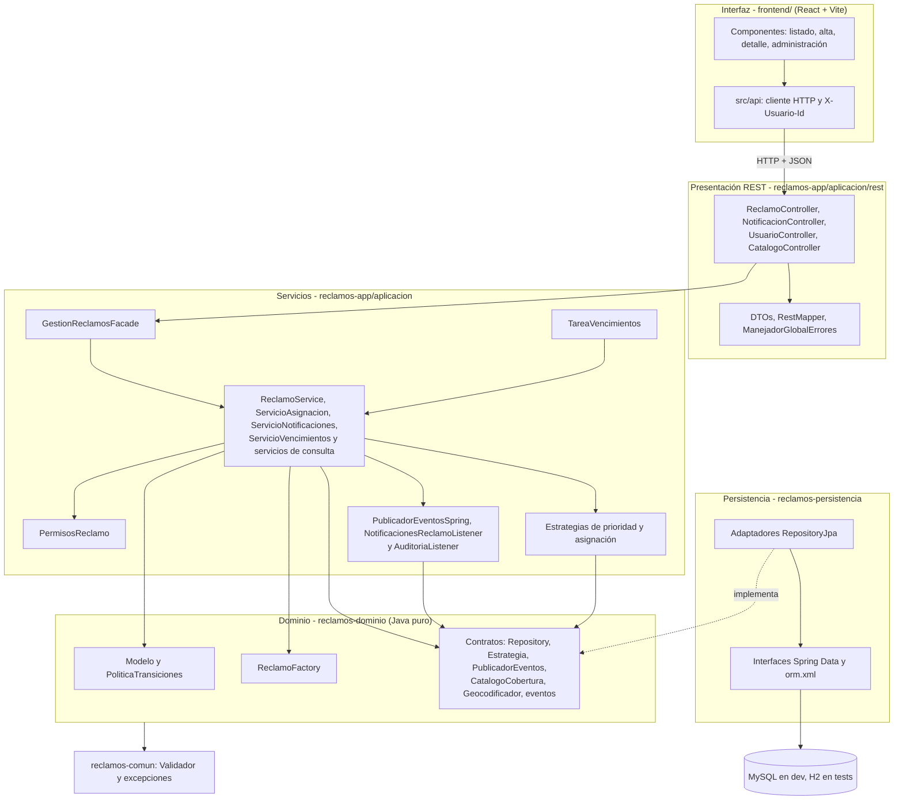
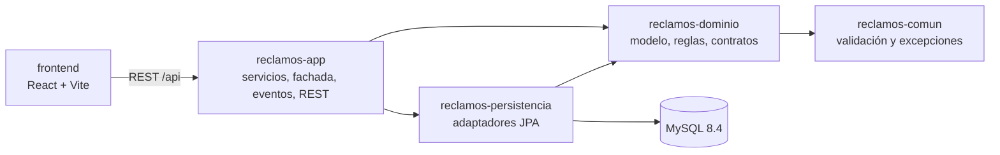

# Arquitectura

El sistema es una aplicación en capas: la interfaz llama a la API REST, la API a los servicios y los
servicios al dominio. El dominio no depende de ningún framework: define interfaces (Repository,
estrategias, integraciones) y las capas de afuera las implementan.

## Capas



El recorrido de una operación es siempre el mismo:

```text
React → Controller → Facade → Servicios → Dominio → Repository → JPA → MySQL
```

| Capa | Dónde está | Responsabilidad | No hace |
| --- | --- | --- | --- |
| Interfaz | `frontend/` | Mostrar reclamos y enviar acciones del usuario | No decide permisos: muestra las `accionesDisponibles` que calcula el backend |
| Presentación REST | `reclamos-app/.../aplicacion/rest` | Traducir HTTP y JSON a llamadas de la fachada; uniformar errores | No tiene lógica de negocio |
| Servicios | `reclamos-app/.../aplicacion` | Coordinar cada caso de uso dentro de una transacción | No conoce HTTP ni JPA |
| Dominio | `reclamos-dominio` | Reglas del negocio, creación del reclamo, contratos | No depende de Spring ni de JPA |
| Persistencia | `reclamos-persistencia` | Implementar los Repository con Spring Data JPA | No tiene reglas de negocio |
| Utilidades | `reclamos-comun` | Validación y excepciones compartidas | No depende de nada |

El detalle de las clases del dominio y de las tablas está en [modelo-dominio.md](modelo-dominio.md).

## Componentes

Cada módulo Maven es un componente con artefacto propio. Las dependencias van en un solo sentido.



## Servicios orientados a componentes

Cada servicio tiene una responsabilidad y se puede probar por separado.

| Servicio | Responsabilidad |
| --- | --- |
| `ReclamoService` | Casos de uso de escritura: crear, asignar, reasignar y cambiar de estado |
| `ServicioAsignacion` | Decidir qué área atiende un reclamo: automática con la estrategia activa, o manual |
| `ServicioNotificaciones` | Decidir a quién se avisa en cada evento y guardar los avisos |
| `ServicioVencimientos` | Marcar los reclamos que pasaron su fecha límite y publicar `ReclamoVencido` |
| `ConsultaReclamosService` | Listar según el rol, buscar por número, avisos y acciones disponibles |
| `ConsultaCatalogosService` | Usuarios, categorías, barrios y áreas |

`PermisosReclamo` no es un servicio de negocio: es el componente que los servicios consultan para saber
quién puede crear y quién puede ver cada reclamo.

Los servicios se integran entre sí de dos formas:

- **Por interfaces.** Dependen de los contratos del dominio (`ReclamoRepository`,
  `EstrategiaPrioridad`, `EstrategiaAsignacion`, `PublicadorEventos`, `CatalogoCobertura`) y Spring
  inyecta la implementación.
- **Por eventos de dominio.** `ReclamoService` y `ServicioVencimientos` publican `ReclamoCreado`,
  `ReclamoAsignado`, `EstadoReclamoCambiado`, `ReclamoResuelto` y `ReclamoVencido`. Dos listeners
  reaccionan sin que quien publica los conozca: `NotificacionesReclamoListener` genera los avisos
  y `AuditoriaListener` registra cada evento.

`TareaVencimientos` ejecuta `ServicioVencimientos` cada minuto. El intervalo se cambia con
`reclamos.vencimientos.intervalo-ms` y la tarea se apaga con `reclamos.vencimientos.habilitado: false`.
Toda la configuración `reclamos.*` está tipada en `PropiedadesReclamos`: una clave mal escrita o un
intervalo que no sea positivo impiden el arranque, en lugar de quedar ignorados.

## Decisiones de diseño

| Decisión | Motivo |
| --- | --- |
| Mapeo JPA en `META-INF/orm.xml` en lugar de anotaciones | El dominio queda sin ninguna dependencia de JPA y se prueba con JUnit solo |
| Interfaces Repository en el dominio, adaptadores en persistencia | Los servicios no dependen de `JpaRepository`; en los tests se reemplazan por dobles en memoria |
| Transiciones en una tabla (`PoliticaTransiciones`) y no con el patrón State | Nueve transiciones se leen mejor en una tabla que repartidas en siete clases |
| Identidad con el encabezado `X-Usuario-Id` | El Hito 1 no pide autenticación; el rol sale del usuario guardado en la base |
| Los avisos se generan dentro de la transacción | Si el listener de avisos falla se revierte todo el caso de uso; no quedan reclamos sin aviso |
| La auditoría corre después del commit | Solo registra hechos confirmados; una operación revertida no deja rastro falso |
| El frontend llama a `/api` en su mismo origen y un proxy reenvía al backend | No hace falta configurar CORS en Spring; funciona igual con Vite y con nginx |
| `accionesDisponibles` en la respuesta del reclamo | La interfaz no repite las reglas de transición: muestra un botón por cada acción |
| `open-in-view: false` y DTOs en REST | No se serializan entidades JPA ni se abren consultas durante la respuesta HTTP |
| Bloqueo optimista con `@Version` en `Reclamo` | Dos operaciones simultáneas sobre el mismo reclamo no se pisan: la segunda recibe `409 CONFLICTO_CONCURRENTE` |
| OpenAPI generado del código con springdoc | El contrato de Swagger no se desactualiza: `OpenApiTest` lo regenera en `docs/openapi/reclamos.yaml` |

## Preparado para la Segunda Parte

El PR 8 dejó listos los puntos de entrada; las integraciones llegan en los PRs 9 a 12. Los contratos de
partida están en [`contratos/`](contratos/README.md).

| Integración | Dónde entra | Qué hay hoy | Qué se agrega |
| --- | --- | --- | --- |
| Prioridad con IA (REST 2) | `EstrategiaPrioridad`, que devuelve `PrioridadCalculada` | `origenPrioridad` y `motivoPrioridad` en `Reclamo` | `PrioridadPorIA` y el servicio `servicio-prioridad` |
| Cobertura por SOAP | `CatalogoCobertura`, que usa `ServicioAsignacion` | `CoberturaLocal` y el modo degradado `asignacionPendiente` | `CoberturaSoap` y el servicio `servicio-cobertura` |
| Geocodificación (API externa) | `Geocodificador` | `Ubicacion` en `Reclamo`, siempre `PENDIENTE` | `GeorefGeocodificador` y la elección de la sugerencia en el alta |
| Mensajería | `ServicioNotificaciones` | Avisos internos | Outbox, RabbitMQ y `servicio-notificaciones` |

`EstrategiaAsignacion` no cambia: sigue eligiendo entre las candidatas, que ahora entrega
`CatalogoCobertura` en lugar del Repository.

## Límites conocidos

- **Avisos simulados.** Las notificaciones se guardan en la base con canal `INTERNO`; no se envían
  correos ni SMS.
- **Sin autenticación.** El usuario se identifica con `X-Usuario-Id`; cualquiera puede elegir
  cualquier usuario.
- **Listados sin paginar.** Los filtros se aplican en memoria sobre los reclamos visibles.
- **Datos maestros de solo lectura.** Áreas, categorías, barrios y usuarios salen de la semilla; no
  hay alta ni edición desde la interfaz.

## Decisiones de la Segunda Parte

| Tema | Decisión |
| --- | --- |
| Geolocalización | El ciudadano sigue eligiendo el barrio. Georef normaliza la dirección y devuelve sugerencias con coordenadas; el ciudadano elige una. No se deduce el barrio |
| Servicio SOAP | Recibe municipio, barrio y categoría y devuelve las áreas que los cubren. Es el dueño de la cobertura |
| IA | Estima la prioridad a partir del texto, con Gemini u OpenAI. La categoría la sigue eligiendo el ciudadano |
| IA sincrónica o por cola | Sincrónica, dentro del alta, con tiempo límite y respaldo por categoría |
| Identificador de mensaje | Cada aviso que sale por RabbitMQ lleva el `eventId` de su fila de outbox; los eventos de dominio no cambian |
| Más de un proceso | Cobertura, prioridad y notificaciones son aplicaciones separadas, en `servicios/` |
