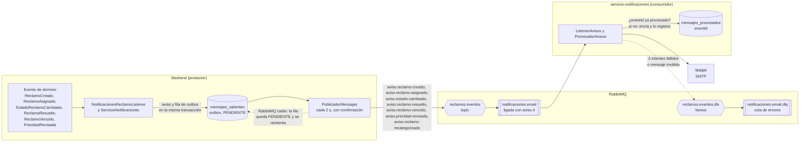
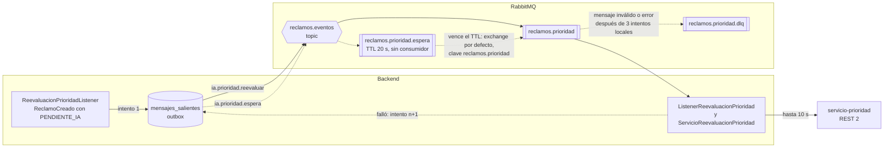
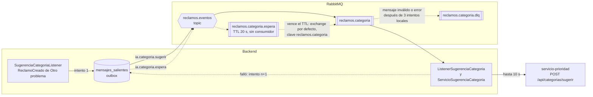

# Contrato de mensajes: RabbitMQ

Implementado en el PR 12. El backend publica un mensaje por cada aviso que genera, y
`servicio-notificaciones` lo consume y envía el correo a Mailpit. Desde el PR 24 el mismo exchange lleva
también los pedidos de [revisión de prioridad por IA](#revisión-de-prioridad-por-ia-pr-24), que el backend
se manda a sí mismo.

| Lado | Dónde |
| --- | --- |
| Productor | Backend: `OutboxAvisos` guarda el mensaje en `mensajes_salientes` y `PublicadorMensajes` lo publica (`reclamos-app/…/aplicacion/mensajeria`) |
| Consumidor | `servicios/servicio-notificaciones`: `ListenerAvisos` y `ProcesadorAvisos` |
| Topología | La declara el consumidor (`TopologiaRabbit`); el backend declara solo el exchange, igual |

## Topología

El flujo de un aviso, del evento de dominio al correo. Las flechas punteadas son los caminos de falla.



| Elemento | Nombre | Tipo |
| --- | --- | --- |
| Exchange | `reclamos.eventos` | `topic`, durable |
| Cola | `notificaciones.email` | durable, ligada con `aviso.#` |
| Exchange de errores | `reclamos.eventos.dlx` | `fanout`, durable |
| Cola de errores | `notificaciones.email.dlq` | durable, ligada a `reclamos.eventos.dlx` |

## Claves de ruteo

Una por evento de dominio que genera avisos:

| Evento de dominio | Clave de ruteo |
| --- | --- |
| `ReclamoCreado` | `aviso.reclamo-creado` |
| `ReclamoAsignado` | `aviso.reclamo-asignado` |
| `EstadoReclamoCambiado` | `aviso.estado-cambiado` |
| `ReclamoResuelto` | `aviso.reclamo-resuelto` |
| `ReclamoVencido` | `aviso.reclamo-vencido` |
| `PrioridadRevisada` (solo si la prioridad cambió) | `aviso.prioridad-revisada` |
| `ReclamoRecategorizado` (PR 26) | `aviso.reclamo-recategorizado` |

## Mensaje

JSON en UTF-8, con `content-type: application/json` y entrega persistente.

```json
{
  "eventId": "6f1c2a9e-4b7d-4e1f-9a52-3c8d0e7b1a44",
  "version": 1,
  "tipoEvento": "ReclamoAsignado",
  "reclamoNumero": "REC-4F2A91BC",
  "destinatario": { "id": 1, "nombre": "Ana Pérez", "email": "ana@example.org" },
  "mensaje": "Tu reclamo REC-4F2A91BC fue asignado al area Alumbrado.",
  "fechaEvento": "2026-10-26T15:00:00-03:00"
}
```

| Campo | Regla |
| --- | --- |
| `eventId` | UUID de la fila de outbox: uno por aviso y destinatario. Lo usa el consumidor para no procesar dos veces |
| `version` | Versión del formato; empieza en 1. Un consumidor rechaza versiones que no conoce |
| `tipoEvento` | Nombre del evento de dominio que generó el aviso |
| `destinatario` | Quién recibe el correo. Nunca DNI, teléfono ni descripción del reclamo |
| `fechaEvento` | ISO-8601 **con** zona horaria, a diferencia de la API REST |

## Garantías y fallas

- **Productor:** el aviso y la fila de outbox se guardan en la misma transacción. Una tarea publica las
  filas pendientes con confirmación del broker y recién entonces las marca publicadas. Si RabbitMQ está
  caído, las filas esperan.
- **Consumidor:** después de enviar el correo registra el `eventId` en su propia base (tabla
  `mensajes_procesados`, con el `eventId` como clave primaria) y recién entonces confirma el mensaje; un
  repetido se confirma sin reenviar el correo. Si el envío falla, tres intentos en total, esperando 1 y 2
  segundos entre ellos; después el mensaje se rechaza y RabbitMQ lo manda a la cola de errores. Un mensaje
  inválido (no es JSON, versión desconocida, faltan campos) va directo a la cola de errores, sin reintentos.
- **Campos nuevos:** el consumidor ignora los campos que no conoce, así el productor puede sumar campos sin
  romperlo. Un cambio incompatible sube `version`.
- **No hay entrega exactamente una vez:** si el consumidor cae después de enviar el correo y antes de
  registrar el `eventId`, el correo se repite al reintentar.

## Revisión de prioridad por IA (PR 24)

Cuando la IA no responde en el alta, el reclamo queda `PENDIENTE_IA` y el backend pide revisarlo después.
El productor y el consumidor son el mismo backend: la cola desacopla la revisión del alta, no dos
servicios. La topología la declara el backend (`TopologiaReevaluacion`) solo si la mensajería está prendida
y la estrategia es `ia`.



| Elemento | Nombre | Tipo |
| --- | --- | --- |
| Cola | `reclamos.prioridad` | durable, ligada con `ia.prioridad.reevaluar`. Al rechazar, va a `reclamos.prioridad.dlq` |
| Cola de espera | `reclamos.prioridad.espera` | durable, ligada con `ia.prioridad.espera`, `x-message-ttl` = `reclamos.prioridad.ia.reevaluacion.espera` (20 s). Al vencer, vuelve a `reclamos.prioridad` |
| Cola de errores | `reclamos.prioridad.dlq` | durable. Separada de `notificaciones.email.dlq` para no mezclar fallas |

```json
{
  "eventId": "0b7e4f7a-2d1c-4a6e-8f0b-9e3c5d2a1b77",
  "version": 1,
  "tipoEvento": "PrioridadPendiente",
  "reclamoNumero": "REC-4F2A91BC",
  "intento": 2,
  "fechaSolicitud": "2026-11-16T21:00:20-03:00"
}
```

| Campo | Regla |
| --- | --- |
| `reclamoNumero` | Lo único que identifica el pedido. **No** lleva la descripción: el backend la lee de su base |
| `intento` | Empieza en 1. Con `intento` igual a `reclamos.prioridad.ia.reevaluacion.intentos` (4) y otra falla, se deja la prioridad de la categoría con origen `RESPALDO` |

- **Idempotencia:** no hace falta registrar el `eventId`. Si el reclamo ya no está `PENDIENTE_IA`, el
  mensaje se confirma sin llamar a la IA.
- **Reintentos de dos tipos:** que la IA no responda es un resultado esperado y se reprograma por la cola de
  espera, sin ocupar un hilo. Un error inesperado (por ejemplo, la base caída) usa los 3 intentos locales de
  Spring y después va a la cola de errores.
- **Mensaje inválido:** no es JSON, versión desconocida, falta el número o `intento` < 1: va directo a la cola
  de errores.

## Sugerencia de categoría por IA (PR 26)

Cuando el vecino elige "Otro problema", el alta deja un pedido para que la IA sugiera la categoría. Sigue el
mismo esquema que la revisión de prioridad: productor y consumidor son el backend, con una cola de espera para
los reintentos y una de errores. La topología (`TopologiaSugerenciaCategoria`) se declara con la mensajería
prendida, la estrategia `ia` y `reclamos.prioridad.ia.sugerir-categoria: true`. Usa los tiempos e intentos de
`reclamos.prioridad.ia.reevaluacion`.



| Elemento | Nombre | Tipo |
| --- | --- | --- |
| Cola | `reclamos.categoria` | durable, ligada con `ia.categoria.sugerir`. Al rechazar, va a `reclamos.categoria.dlq` |
| Cola de espera | `reclamos.categoria.espera` | durable, ligada con `ia.categoria.espera`, `x-message-ttl` = `reclamos.prioridad.ia.reevaluacion.espera` (20 s). Al vencer, vuelve a `reclamos.categoria` |
| Cola de errores | `reclamos.categoria.dlq` | durable |

```json
{
  "eventId": "5d1f0c2e-8a3b-4b71-9f6d-2c4e7a9b1d03",
  "version": 1,
  "tipoEvento": "CategoriaPendiente",
  "reclamoNumero": "REC-4F2A91BC",
  "intento": 1,
  "fechaSolicitud": "2026-11-16T21:00:00-03:00"
}
```

| Campo | Regla |
| --- | --- |
| `reclamoNumero` | Lo único que identifica el pedido. **No** lleva lo que escribió el vecino ni la descripción: el backend los lee de su base |
| `intento` | Empieza en 1. En el último intento, si la IA sigue sin responder, el reclamo guarda "La IA no respondió en 4 intentos: elegí la categoría a mano." como motivo y sin categoría sugerida |

- **Qué recibe la IA:** lo que escribió el vecino (`categoriaPropuesta`), la descripción y los nombres de las
  categorías concretas. Nada que identifique al vecino.
- **Idempotencia:** si el reclamo ya tiene sugerencia o ya se recategorizó, el mensaje se confirma sin llamar a
  la IA.
- **Una categoría inventada:** si la IA responde una categoría que no estaba en la lista, cuenta como falla y se
  reintenta.
- **Mensaje inválido:** igual que en la revisión de prioridad, va directo a la cola de errores.

## Aviso de recategorización (PR 26)

Cuando un administrador cambia la categoría, el backend avisa al vecino con `tipoEvento`
`ReclamoRecategorizado` y clave `aviso.reclamo-recategorizado`. La cola `notificaciones.email` ya escucha
`aviso.#`: `servicio-notificaciones` lo recibe sin cambios de topología. El asunto del correo es "Reclamo
REC-…: cambió de categoría".
