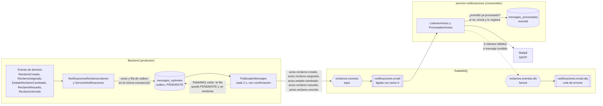

# Contrato de mensajes: RabbitMQ

Implementado en el PR 12. El backend publica un mensaje por cada aviso que genera, y
`servicio-notificaciones` lo consume y envía el correo a Mailpit.

| Lado | Dónde |
| --- | --- |
| Productor | Backend: `OutboxAvisos` guarda el mensaje en `mensajes_salientes` y `PublicadorMensajes` lo publica (`reclamos-app/…/aplicacion/mensajeria`) |
| Consumidor | `servicios/servicio-notificaciones`: `ListenerAvisos` y `ProcesadorAvisos` |
| Topología | La declara el consumidor (`TopologiaRabbit`); el backend declara solo el exchange, igual |

## Topología

El flujo de un aviso, del evento de dominio al correo. Las flechas punteadas son los caminos de falla.



| Elemento | Nombre | Tipo |
| --- | --- | --- |
| Exchange | `reclamos.eventos` | `topic`, durable |
| Cola | `notificaciones.email` | durable, ligada con `aviso.#` |
| Exchange de errores | `reclamos.eventos.dlx` | `fanout`, durable |
| Cola de errores | `notificaciones.email.dlq` | durable, ligada a `reclamos.eventos.dlx` |

## Claves de ruteo

Una por evento de dominio que genera avisos:

| Evento de dominio | Clave de ruteo |
| --- | --- |
| `ReclamoCreado` | `aviso.reclamo-creado` |
| `ReclamoAsignado` | `aviso.reclamo-asignado` |
| `EstadoReclamoCambiado` | `aviso.estado-cambiado` |
| `ReclamoResuelto` | `aviso.reclamo-resuelto` |
| `ReclamoVencido` | `aviso.reclamo-vencido` |

## Mensaje

JSON en UTF-8, con `content-type: application/json` y entrega persistente.

```json
{
  "eventId": "6f1c2a9e-4b7d-4e1f-9a52-3c8d0e7b1a44",
  "version": 1,
  "tipoEvento": "ReclamoAsignado",
  "reclamoNumero": "REC-4F2A91BC",
  "destinatario": { "id": 1, "nombre": "Ana Pérez", "email": "ana@example.org" },
  "mensaje": "Tu reclamo REC-4F2A91BC fue asignado al area Alumbrado.",
  "fechaEvento": "2026-10-26T15:00:00-03:00"
}
```

| Campo | Regla |
| --- | --- |
| `eventId` | UUID de la fila de outbox: uno por aviso y destinatario. Lo usa el consumidor para no procesar dos veces |
| `version` | Versión del formato; empieza en 1. Un consumidor rechaza versiones que no conoce |
| `tipoEvento` | Nombre del evento de dominio que generó el aviso |
| `destinatario` | Quién recibe el correo. Nunca DNI, teléfono ni descripción del reclamo |
| `fechaEvento` | ISO-8601 **con** zona horaria, a diferencia de la API REST |

## Garantías y fallas

- **Productor:** el aviso y la fila de outbox se guardan en la misma transacción. Una tarea publica las
  filas pendientes con confirmación del broker y recién entonces las marca publicadas. Si RabbitMQ está
  caído, las filas esperan.
- **Consumidor:** después de enviar el correo registra el `eventId` en su propia base (tabla
  `mensajes_procesados`, con el `eventId` como clave primaria) y recién entonces confirma el mensaje; un
  repetido se confirma sin reenviar el correo. Si el envío falla, tres intentos en total, esperando 1 y 2
  segundos entre ellos; después el mensaje se rechaza y RabbitMQ lo manda a la cola de errores. Un mensaje
  inválido (no es JSON, versión desconocida, faltan campos) va directo a la cola de errores, sin reintentos.
- **Campos nuevos:** el consumidor ignora los campos que no conoce, así el productor puede sumar campos sin
  romperlo. Un cambio incompatible sube `version`.
- **No hay entrega exactamente una vez:** si el consumidor cae después de enviar el correo y antes de
  registrar el `eventId`, el correo se repite al reintentar.
