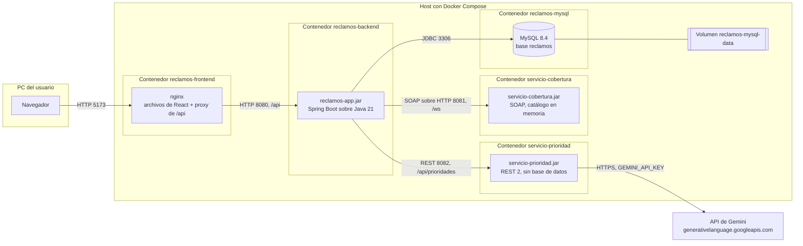

# Despliegue

El sistema se despliega en cinco contenedores. El navegador solo habla con el contenedor del
frontend, que sirve la interfaz y reenvía las llamadas a `/api` al backend. El backend consulta la
cobertura al servicio SOAP y la prioridad al servicio de IA por la red interna de Compose; solo el
servicio de IA sale a Internet, a la API de Gemini.

| Contenedor | Imagen | Puerto publicado | Qué contiene |
| --- | --- | --- | --- |
| `reclamos-frontend` | `nginx:1.27-alpine`, construida desde `frontend/Dockerfile` | 5173 | Interfaz React compilada y proxy de `/api` |
| `reclamos-backend` | `eclipse-temurin:21-jre`, construida desde `backend/Dockerfile` | 8080 | `reclamos-app.jar`, que incluye los cuatro módulos Maven |
| `reclamos-mysql` | `mysql:8.4` | 3306 | Base de datos, con los datos en un volumen |
| `servicio-cobertura` | `eclipse-temurin:21-jre`, construida desde `servicios/servicio-cobertura/Dockerfile` | 8081 | Servicio SOAP de cobertura; el WSDL queda en `http://localhost:8081/ws/cobertura.wsdl` |
| `servicio-prioridad` | `eclipse-temurin:21-jre`, construida desde `servicios/servicio-prioridad/Dockerfile` | 8082 | Servicio de prioridad con IA (REST 2); Swagger UI en `http://localhost:8082/swagger-ui.html` |

Los puertos 8081 y 8082 se publican para poder abrir el WSDL y Swagger y probar los servicios desde la
máquina; el backend no los necesita, porque llega por la red de Compose con el nombre de cada servicio.

## Configuración externalizada

| Variable | Dónde se usa | Para qué |
| --- | --- | --- |
| `DB_NAME`, `DB_USER`, `DB_PASSWORD`, `MYSQL_ROOT_PASSWORD`, `DB_PORT` | `.env`, leído por Compose | Credenciales y puerto de MySQL |
| `DB_URL` | Contenedor del backend | URL de conexión; apunta al servicio `mysql` de la red de Compose |
| `reclamos.prioridad.estrategia`, `reclamos.asignacion.estrategia` | `application.yml` | Estrategias activas |
| `reclamos.vencimientos.habilitado`, `reclamos.vencimientos.intervalo-ms` | `application.yml` | Control de vencimientos |
| `reclamos.cobertura.origen` | `application.yml`; `RECLAMOS_COBERTURA_ORIGEN` en Compose | De dónde salen las áreas candidatas: `local` (la base) o `soap`. En Compose es `soap` |
| `reclamos.cobertura.url` | `application.yml`; `RECLAMOS_COBERTURA_URL` en Compose | Dirección del servicio SOAP: `http://localhost:8081/ws` en desarrollo, `http://servicio-cobertura:8081/ws` entre contenedores |
| `reclamos.cobertura.tiempo-limite` | `application.yml` | Cuánto se espera al servicio SOAP antes de dejar la asignación pendiente; 2 segundos |
| `cobertura.catalogo` | `application.yml` de `servicio-cobertura` | Archivo del catálogo de cobertura |
| `reclamos.prioridad.estrategia` en `ia` | `RECLAMOS_PRIORIDAD_ESTRATEGIA` en Compose | La prioridad la sugiere el servicio de IA, con respaldo por categoría |
| `reclamos.prioridad.ia.*` | `application.yml`; `RECLAMOS_PRIORIDAD_IA_URL` en Compose | Dirección de REST 2, tiempos (1 s para conectar, 6 s para responder) y circuit breaker |
| `GEMINI_API_KEY` | `.env`, leído por Compose; contenedor `servicio-prioridad` | Clave de Gemini. Sin clave el servicio responde 503 y el backend usa el respaldo. **Nunca se commitea** |
| `PRIORIDAD_IA_PROVEEDOR` | `.env`; contenedor `servicio-prioridad` | `gemini` (por defecto), `openai` o `simulado` |
| `OPENAI_API_KEY` | `.env`; contenedor `servicio-prioridad` | Solo si se usa `openai` |
| `springdoc.*` | `application.yml` | Swagger UI en `/swagger-ui.html`, publicado por el puerto 8080 del backend |
| `VITE_BACKEND_URL` | `frontend/.env`, solo en desarrollo | Adónde reenvía Vite las llamadas a `/api` |

## Dos formas de ejecutar

| Modo | MySQL | Backend | Frontend | Comando |
| --- | --- | --- | --- | --- |
| Desarrollo | Contenedor | En la máquina, con Maven | En la máquina, con Vite | `docker compose up -d mysql` y después backend y frontend a mano |
| Demo | Contenedor | Contenedor | Contenedor | `docker compose up --build` |

En desarrollo el backend usa la cobertura local; para probar el SOAP se levanta `servicio-cobertura` con
`./mvnw -pl servicio-cobertura spring-boot:run` desde `servicios/` (o `docker compose up -d servicio-cobertura`)
y se arranca el backend con `RECLAMOS_COBERTURA_ORIGEN=soap`. Lo mismo con la IA: se levanta
`servicio-prioridad` y se arranca el backend con `RECLAMOS_PRIORIDAD_ESTRATEGIA=ia`.

En desarrollo el proxy de `/api` lo hace Vite; en la demo lo hace nginx. Para el navegador es lo
mismo: siempre llama a `/api` en el origen de la interfaz.
