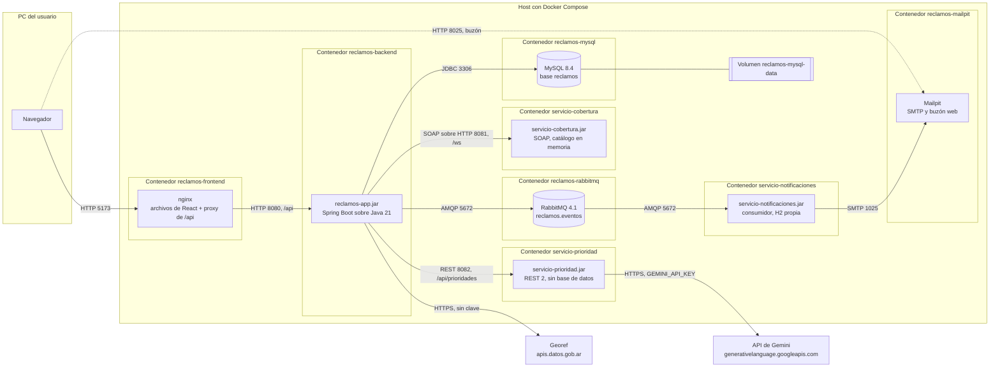
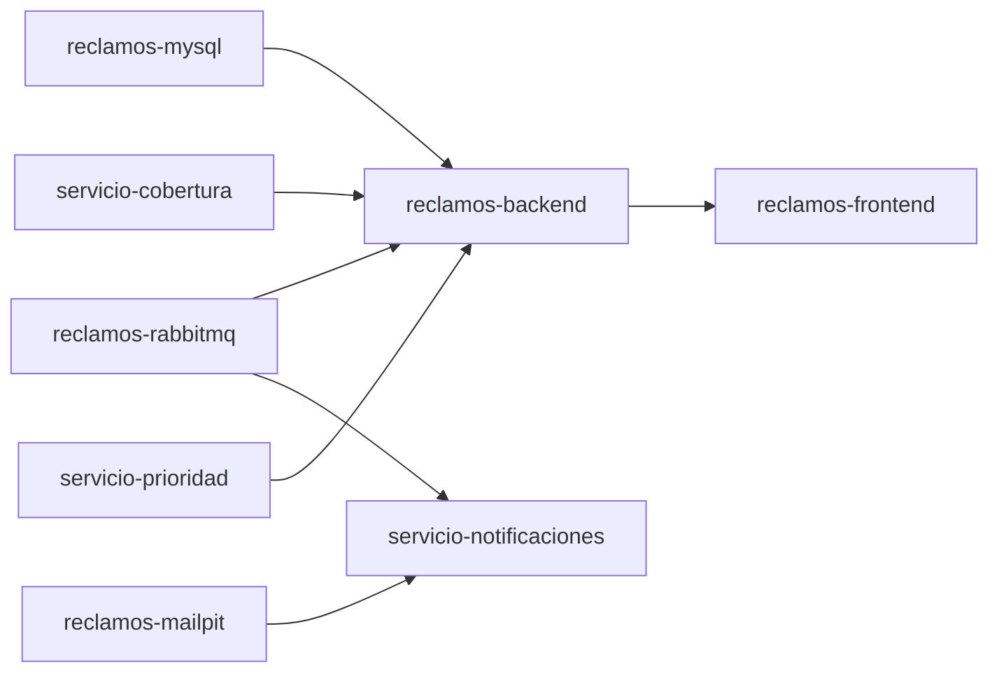

# Despliegue

El sistema se despliega en ocho contenedores. El navegador solo habla con el contenedor del
frontend, que sirve la interfaz y reenvía las llamadas a `/api` al backend. El backend consulta la
cobertura al servicio SOAP y la prioridad al servicio de IA por la red interna de Compose. Salen a
Internet el servicio de IA, a la API de Gemini, y el backend, a Georef para ubicar las direcciones.

| Contenedor | Imagen | Puerto publicado | Qué contiene |
| --- | --- | --- | --- |
| `reclamos-frontend` | `nginx:1.27-alpine`, construida desde `frontend/Dockerfile` | 5173 | Interfaz React compilada y proxy de `/api` |
| `reclamos-backend` | `eclipse-temurin:21-jre`, construida desde `backend/Dockerfile` | 8080 | `reclamos-app.jar`, que incluye los cuatro módulos Maven |
| `reclamos-mysql` | `mysql:8.4` | 3306 | Base de datos, con los datos en un volumen |
| `servicio-cobertura` | `eclipse-temurin:21-jre`, construida desde `servicios/servicio-cobertura/Dockerfile` | 8081 | Servicio SOAP de cobertura; el WSDL queda en `http://localhost:8081/ws/cobertura.wsdl` |
| `servicio-prioridad` | `eclipse-temurin:21-jre`, construida desde `servicios/servicio-prioridad/Dockerfile` | 8082 | Servicio de prioridad con IA (REST 2); Swagger UI en `http://localhost:8082/swagger-ui.html` |
| `reclamos-rabbitmq` | `rabbitmq:4.1-management` | 5672 y 15672 | Broker de mensajes, con sus datos en un volumen; consola web en `http://localhost:15672` |
| `servicio-notificaciones` | `eclipse-temurin:21-jre`, construida desde `servicios/servicio-notificaciones/Dockerfile` | Ninguno | Consumidor de la cola `notificaciones.email`; guarda los `eventId` procesados en el volumen `notificaciones-datos` |
| `reclamos-mailpit` | `axllent/mailpit` | 1025 y 8025 | SMTP de prueba; los correos se ven en `http://localhost:8025` |

Los puertos 8081 y 8082 se publican para poder abrir el WSDL y Swagger y probar los servicios desde la
máquina; el backend no los necesita, porque llega por la red de Compose con el nombre de cada servicio.

## Arranque, salud y memoria

Compose levanta los contenedores en orden y espera a que cada uno esté **sano** antes de arrancar el que
depende de él. Así el primer reclamo de la demo ya pasa por la IA y por el SOAP, en lugar de caer en el
respaldo porque el servicio todavía estaba arrancando.

| Contenedor | Cuándo está sano | Cómo se comprueba |
| --- | --- | --- |
| `reclamos-mysql` | Acepta conexiones del usuario de la aplicación | `mysqladmin ping` |
| `reclamos-rabbitmq` | El broker responde | `rabbitmq-diagnostics ping` |
| `servicio-cobertura`, `servicio-prioridad`, `reclamos-backend` | Spring Boot terminó de arrancar y abrió su puerto | `bash` abre una conexión al puerto: la imagen `eclipse-temurin` no trae `curl` |
| `reclamos-frontend` | nginx sirve la interfaz | `wget --spider` |
| `servicio-notificaciones`, `reclamos-mailpit` | Están corriendo | Sin chequeo propio: nadie espera por ellos para arrancar |

Cada flecha va del contenedor que tiene que estar listo al que lo espera, y vale solo para el arranque. Si un servicio se cae después, el backend sigue andando con su respaldo
(ver la [matriz de fallos](demo.md#matriz-de-fallos)).

**Memoria.** Cada servicio Java tiene un tope de heap en `JAVA_TOOL_OPTIONS`, con el recolector serial, que
ocupa menos memoria que el predeterminado:

| Contenedor | Heap máximo |
| --- | --- |
| `reclamos-backend` | 512 MB |
| `servicio-cobertura`, `servicio-prioridad`, `servicio-notificaciones` | 256 MB cada uno |

Con lo que suma cada JVM fuera del heap, más MySQL y RabbitMQ, el total estimado ronda los 2,5 GB: alcanza con
asignarle 4 GB a Docker Desktop. El consumo real de cada contenedor lo muestra el trabajo «Demo completa» del
CI, en el paso «Memoria de cada contenedor».

**Construcción.** Los cuatro Dockerfile de Java compilan con Maven dentro de la imagen y guardan las
dependencias en una caché de BuildKit (`RUN --mount=type=cache`). La primera construcción las baja de Internet;
las siguientes las toman de la caché, aunque cambie el código.

**Verificación.** `docker compose run --rm verificar-demo` corre `scripts/verificar-demo.mjs` en un contenedor
de Node, dentro de la misma red: crea un reclamo y sigue su recorrido por las cinco integraciones. Ese
contenedor está en el perfil `verificacion`, así que `docker compose up` no lo levanta. El detalle está en
[demo.md](demo.md#verificación-automática).

## Configuración externalizada

| Variable | Dónde se usa | Para qué |
| --- | --- | --- |
| `DB_NAME`, `DB_USER`, `DB_PASSWORD`, `MYSQL_ROOT_PASSWORD`, `DB_PORT` | `.env`, leído por Compose | Credenciales y puerto de MySQL |
| `DB_URL` | Contenedor del backend | URL de conexión; apunta al servicio `mysql` de la red de Compose |
| `reclamos.prioridad.estrategia`, `reclamos.asignacion.estrategia` | `application.yml` | Estrategias activas |
| `reclamos.vencimientos.habilitado`, `reclamos.vencimientos.intervalo-ms` | `application.yml` | Control de vencimientos |
| `reclamos.cobertura.origen` | `application.yml`; `RECLAMOS_COBERTURA_ORIGEN` en Compose | De dónde salen las áreas candidatas: `local` (la base) o `soap`. En Compose es `soap` |
| `reclamos.cobertura.url` | `application.yml`; `RECLAMOS_COBERTURA_URL` en Compose | Dirección del servicio SOAP: `http://localhost:8081/ws` en desarrollo, `http://servicio-cobertura:8081/ws` entre contenedores |
| `reclamos.cobertura.tiempo-limite` | `application.yml` | Cuánto se espera al servicio SOAP antes de dejar la asignación pendiente; 2 segundos |
| `cobertura.catalogo` | `application.yml` de `servicio-cobertura` | Archivo del catálogo de cobertura |
| `reclamos.prioridad.estrategia` en `ia` | `RECLAMOS_PRIORIDAD_ESTRATEGIA` en Compose | La prioridad la sugiere el servicio de IA, con respaldo por categoría |
| `reclamos.prioridad.ia.*` | `application.yml`; `RECLAMOS_PRIORIDAD_IA_URL` en Compose | Dirección de REST 2, tiempos (1 s para conectar, 6 s para responder) y circuit breaker |
| `GEMINI_API_KEY` | `.env`, leído por Compose; contenedor `servicio-prioridad` | Clave de Gemini. Sin clave el servicio responde 503 y el backend usa el respaldo. **Nunca se commitea** |
| `PRIORIDAD_IA_PROVEEDOR` | `.env`; contenedor `servicio-prioridad` | `gemini` (por defecto), `openai` o `simulado` |
| `OPENAI_API_KEY` | `.env`; contenedor `servicio-prioridad` | Solo si se usa `openai` |
| `reclamos.geocodificacion.*` | `application.yml` | Georef: URL, tiempos (1 s y 3 s), cantidad de sugerencias, caché de 10 minutos y recuadro de cada municipio. No usa clave |
| `reclamos.mensajeria.habilitada` | `application.yml` (`false`); `RECLAMOS_MENSAJERIA_HABILITADA` en Compose (`true`) | Outbox y publicación en RabbitMQ. Apagada, los avisos quedan solo internos |
| `RABBITMQ_USER`, `RABBITMQ_PASSWORD` | `.env`, leído por Compose; backend y `servicio-notificaciones` | Usuario de RabbitMQ. El usuario `guest` solo entra desde el mismo contenedor, por eso Compose crea este |
| `RABBITMQ_HOST`, `SMTP_HOST`, `SMTP_PORT` | Contenedores del backend y del consumidor | `rabbitmq` y `mailpit` entre contenedores; `localhost` en desarrollo |
| `springdoc.*` | `application.yml` | Swagger UI en `/swagger-ui.html`, publicado por el puerto 8080 del backend |
| `JAVA_TOOL_OPTIONS` | `docker-compose.yml`, en cada servicio Java | Tope de heap y recolector serial (ver «Arranque, salud y memoria») |
| `server.servlet.session.*` | `application.yml` del backend | Sesión del login: vence a los 30 minutos sin uso; cookie `JSESSIONID` `HttpOnly` y `SameSite=Lax` |
| `springdoc.swagger-ui.csrf.enabled` | `application.yml` del backend | Swagger UI manda el token CSRF, así se puede probar con el login |
| `reclamos.uso.*` | `application.yml`; `RECLAMOS_USO_RECLAMOS_POR_DIA` en Compose | Reclamos por día (5; Compose lo sube a 20 para la demo), códigos de verificación por hora (3) y vigencia del código (10 minutos) |
| `reclamos.reaperturas.*` | `application.yml` | Máximo de reaperturas (1) y plazo desde la última resolución (7 días) |
| `RECLAMOS_TELEGRAM_MODO` | `.env`, leído por Compose; contenedor del backend | `simulado` (por defecto, sin bot) o `telegram` |
| `TELEGRAM_BOT_TOKEN`, `TELEGRAM_BOT_USUARIO` | `.env`, leído por Compose; contenedor del backend | Token y usuario del bot creado con @BotFather. Obligatorios con el modo `telegram`. **El token nunca se commitea** y no aparece en los logs |
| `VITE_BACKEND_URL` | `frontend/.env`, solo en desarrollo | Adónde reenvía Vite las llamadas a `/api` |

## Dos formas de ejecutar

| Modo | MySQL | Backend | Frontend | Comando |
| --- | --- | --- | --- | --- |
| Desarrollo | Contenedor | En la máquina, con Maven | En la máquina, con Vite | `docker compose up -d mysql` y después backend y frontend a mano |
| Demo | Contenedor | Contenedor | Contenedor | `docker compose up --build` |
| Verificación de la demo | — | — | — | Con la demo levantada: `docker compose run --rm verificar-demo` |

En desarrollo el backend usa la cobertura local; para probar el SOAP se levanta `servicio-cobertura` con
`./mvnw -pl servicio-cobertura spring-boot:run` desde `servicios/` (o `docker compose up -d servicio-cobertura`)
y se arranca el backend con `RECLAMOS_COBERTURA_ORIGEN=soap`. Lo mismo con la IA: se levanta
`servicio-prioridad` y se arranca el backend con `RECLAMOS_PRIORIDAD_ESTRATEGIA=ia`.

En desarrollo el proxy de `/api` lo hace Vite; en la demo lo hace nginx. Para el navegador es lo
mismo: siempre llama a `/api` en el origen de la interfaz.
