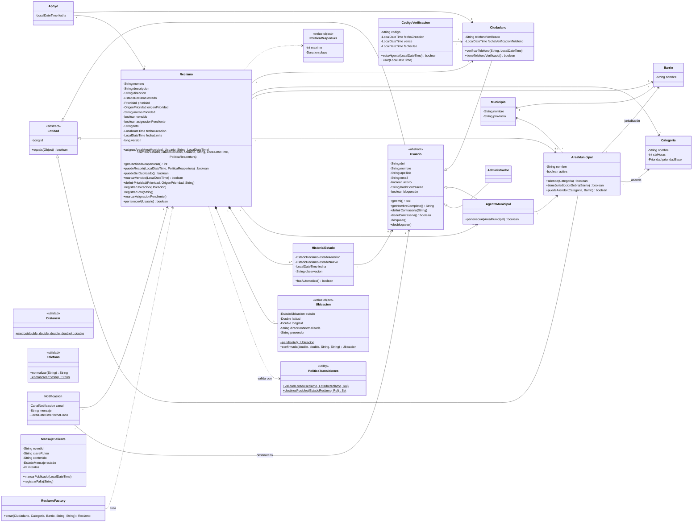
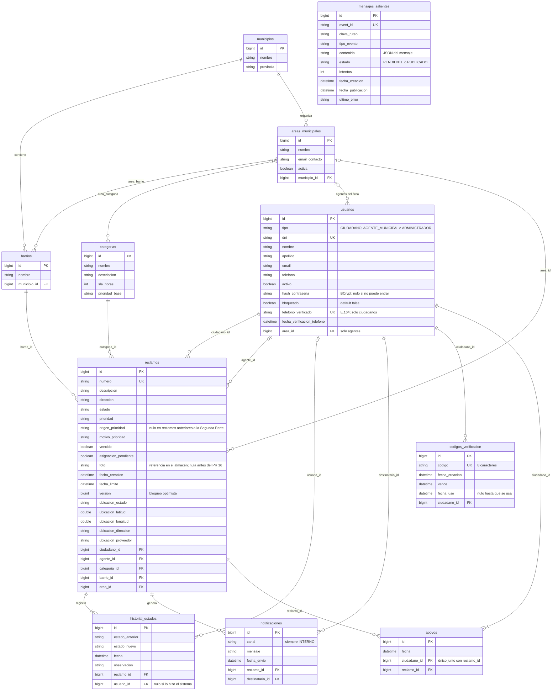

# Modelo de dominio

El dominio está en el módulo `reclamos-dominio`, paquete `ar.edu.uade.reclamos.dominio.modelo`. Son
clases Java sin anotaciones: el mapeo a tablas está aparte, en
`reclamos-persistencia/src/main/resources/META-INF/orm.xml`.

## Clases

`Reclamo` es la clase central: protege su estado, valida cada cambio contra `PoliticaTransiciones`
y registra su propio historial.

`Municipio`, `Barrio`, `Categoria`, `HistorialEstado`, `Notificacion` y `MensajeSaliente` también heredan
de `Entidad`; no se dibuja para no cargar el diagrama. `Ubicacion` no es una entidad: es un valor que se
guarda en columnas de la tabla `reclamos`. `MensajeSaliente` no tiene reglas de negocio: es la fila de la
outbox (tabla `mensajes_salientes`) con un aviso que tiene que salir por RabbitMQ.

| Enum | Valores |
| --- | --- |
| `EstadoReclamo` | `INGRESADO`, `ASIGNADO`, `EN_PROCESO`, `RESUELTO`, `CERRADO`, `RECHAZADO`, `CANCELADO` |
| `Prioridad` | `BAJA`, `MEDIA`, `ALTA`, `CRITICA` |
| `Rol` | `CIUDADANO`, `AGENTE_MUNICIPAL`, `ADMINISTRADOR`, `SISTEMA` |
| `CanalNotificacion` | `EMAIL`, `SMS`, `INTERNO` |
| `OrigenPrioridad` | `CATEGORIA`, `PALABRAS_CLAVE`, `IA`, `RESPALDO` |
| `EstadoUbicacion` | `CONFIRMADA`, `PENDIENTE` |
| `EstadoMensaje` | `PENDIENTE`, `PUBLICADO` |

`Rol.SISTEMA` no corresponde a ningún usuario: representa las acciones automáticas, como la
asignación al crear el reclamo. Todos los avisos se guardan con el canal `INTERNO`; con la mensajería
habilitada, además salen por correo a través de la outbox.

## Reglas que viven en el dominio

| Regla | Dónde está |
| --- | --- |
| Qué transiciones de estado existen y qué rol puede ejecutar cada una | `PoliticaTransiciones` |
| Un ciudadano solo opera sobre sus reclamos; un agente, sobre los de su área | `Reclamo.cambiarEstado` |
| Solo se asigna a un área activa y distinta de la actual | `Reclamo.asignarArea` |
| Un área puede atender si está activa, atiende la categoría y cubre el barrio | `AreaMunicipal.puedeAtender` |
| Un reclamo vence una sola vez y sube un nivel de prioridad | `Reclamo.marcarVencido` |
| Solo un reclamo `INGRESADO` queda con la asignación pendiente; asignarle un área la borra | `Reclamo.marcarAsignacionPendiente` y `asignarArea` |
| Una ubicación confirmada tiene coordenadas válidas, dirección y proveedor; nunca se inventan | `Ubicacion.confirmada` |
| Una ubicación solo se confirma si el ciudadano eligió una sugerencia del geocodificador dentro de su municipio | `ServicioUbicaciones.confirmar` |
| Todo reclamo nace `INGRESADO`, con número, fecha límite e historial | `ReclamoFactory.crear` |
| Un usuario guarda el hash de su contraseña, nunca la contraseña; un hash vacío no se acepta | `Usuario.definirContrasena` |
| Reabrir exige motivo, se permite hasta `maximo` veces y dentro de `plazo` desde la última resolución; ambos datos salen del historial | `Reclamo.cambiarEstado` con `PoliticaReapertura` |
| Un teléfono se guarda en E.164, de 8 a 15 dígitos, y se muestra enmascarado | `Telefono.normalizar` y `enmascarar` |
| Un código de verificación se usa una sola vez y antes de vencer | `CodigoVerificacion.usar` |
| Un reclamo guarda la referencia a su foto una sola vez; no se reemplaza | `Reclamo.registrarFoto` |
| Solo un reclamo abierto y con la ubicación confirmada aparece como posible duplicado | `Reclamo.puedeSerDuplicado` |
| Nadie apoya su propio reclamo ni uno que ya no está abierto; apoyar no cambia la prioridad | Constructor de `Apoyo` |

El ciclo de vida completo está en [secuencias.md](secuencias.md#ciclo-de-vida-del-reclamo).

## Tablas

Tablas y columnas tal como las define `orm.xml`. Los tres tipos de usuario comparten la tabla
`usuarios` y se distinguen por la columna `tipo`. Las relaciones muchos a muchos usan las tablas
`area_barrio` y `area_categoria`.

`mensajes_salientes` es la outbox: no tiene claves foráneas, porque el mensaje ya lleva todo lo que necesita
el consumidor y tiene que poder publicarse aunque cambien los datos del reclamo.

`telefono_verificado` es único: es lo que asegura "un número, una cuenta" aun si dos confirmaciones llegan a la
vez. El campo `telefono` es el que se cargó en el alta, sin verificar; el que cuenta para crear reclamos es
`telefono_verificado`.
