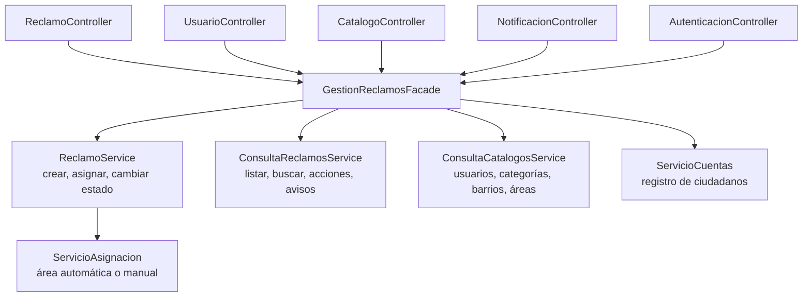
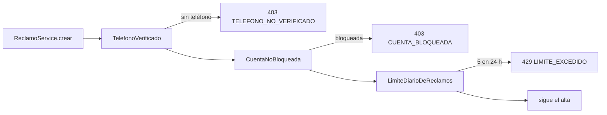

# Patrones de diseño aplicados

Los cinco patrones que pide la Primera Parte, con el problema que resuelve cada uno en este sistema,
las clases que lo implementan y cómo comprobarlo. Al final están los que suma la Segunda Parte.

Las rutas son relativas a `backend/`. `…` abrevia `src/main/java/ar/edu/uade/reclamos`.

| Patrón | Para qué se usa | Clases principales |
| --- | --- | --- |
| Factory | Crear reclamos siempre consistentes | `ReclamoFactory` |
| Repository | Separar el negocio de la base de datos | 7 interfaces en el dominio, 7 adaptadores JPA |
| Strategy | Cambiar por configuración cómo se calcula la prioridad y cómo se asigna el área | `EstrategiaPrioridad`, `EstrategiaAsignacion` y sus 4 implementaciones |
| Observer | Reaccionar a lo que pasa con un reclamo sin acoplar componentes | `PublicadorEventos`, `NotificacionesReclamoListener`, `AuditoriaListener` |
| Facade | Dar a los controladores una única entrada a los casos de uso | `GestionReclamosFacade` |

## Factory

**Problema.** Un reclamo válido necesita número, estado inicial, fechas, prioridad y un primer
registro de historial. Si cada lugar que crea reclamos armara eso por su cuenta, tarde o temprano
alguno quedaría incompleto.

**Solución.** `ReclamoFactory` es el único lugar donde nace un reclamo.

| Qué garantiza | Cómo |
| --- | --- |
| Número único | `REC-` más ocho caracteres hexadecimales |
| Estado inicial | Siempre `INGRESADO` |
| Fecha límite | Fecha de creación más las horas de SLA de la categoría |
| Prioridad inicial | La prioridad base de la categoría |
| Historial | Primer registro: ingreso, a nombre del ciudadano |
| Validaciones | Rechaza datos faltantes y ciudadanos inactivos |

```java
public Reclamo crear(Ciudadano ciudadano, Categoria categoria, Barrio barrio,
                     String descripcion, String direccion) {
    // ...validaciones...
    LocalDateTime ahora = LocalDateTime.now(reloj).truncatedTo(ChronoUnit.SECONDS);
    LocalDateTime fechaLimite = ahora.plusHours(categoria.getSlaHoras());
    return new Reclamo(generarNumero(), ciudadano, categoria, barrio, descripcion, direccion,
            categoria.getPrioridadBase(), ahora, fechaLimite);
}
```

Recibe un `Clock`, de modo que los tests fijan la fecha y comprueban el cálculo del SLA.

- **Código:** `reclamos-dominio/…/dominio/fabrica/ReclamoFactory.java`
- **Quién la usa:** `ReclamoService.crear`
- **Tests:** `ReclamoFactoryTest`

## Repository

**Problema.** Si los servicios usaran JPA directamente, el negocio quedaría atado a la base de
datos y no se podría probar sin ella.

**Solución.** El dominio define **qué** necesita (interfaces) y la persistencia decide **cómo**
(adaptadores). Hay tres piezas por entidad:

```text
ReclamoRepository          interfaz del dominio; es lo único que ven los servicios
        ▲ implementa
ReclamoRepositoryJpa       adaptador en reclamos-persistencia
        │ delega
ReclamoJpaRepository       interfaz Spring Data JPA
```

```java
public interface ReclamoRepository {
    Reclamo guardar(Reclamo reclamo);
    Optional<Reclamo> buscarPorNumero(String numero);
    List<Reclamo> buscarPorCiudadano(Long ciudadanoId);
    List<Reclamo> buscarPorArea(Long areaId);
    long contarPendientesPorArea(Long areaId);
    // ...
}
```

Las siete interfaces son `ReclamoRepository`, `UsuarioRepository`, `MunicipioRepository`,
`BarrioRepository`, `AreaMunicipalRepository`, `CategoriaRepository` y `NotificacionRepository`.
El mapeo objeto-relacional está en `META-INF/orm.xml`, así que las clases del dominio no tienen
anotaciones de JPA.

- **Código:** `reclamos-dominio/…/dominio/repositorio/` y `reclamos-persistencia/…/persistencia/`
- **Quién lo usa:** todos los servicios y `AsignacionPorCargaDeTrabajo`
- **Tests:** `ReclamoRepositoryJpaTest`, `AreaMunicipalRepositoryJpaTest` y el resto de
  `reclamos-persistencia`, contra H2

## Strategy

**Problema.** Hay más de una forma razonable de calcular la prioridad y de elegir el área, y en el
Hito 2 se suman otras (IA, servicio SOAP). Con condicionales dentro del servicio, cada variante
nueva obligaría a modificarlo.

**Solución.** Dos familias de algoritmos intercambiables, cada una detrás de una interfaz.

| Interfaz | Implementación | Algoritmo | Valor de configuración |
| --- | --- | --- | --- |
| `EstrategiaPrioridad` | `PrioridadPorCategoria` | Devuelve la prioridad base de la categoría | `categoria` |
| `EstrategiaPrioridad` | `PrioridadPorPalabrasClave` | Si la descripción dice urgente, peligro, riesgo o accidente, sube como mínimo a `ALTA` | `palabras-clave` |
| `EstrategiaAsignacion` | `AsignacionPorJurisdiccion` | Entre las áreas candidatas, la de menor id | `jurisdiccion` |
| `EstrategiaAsignacion` | `AsignacionPorCargaDeTrabajo` | Entre las áreas candidatas, la que tiene menos reclamos pendientes | `carga-trabajo` |

Las áreas candidatas son las activas que atienden la categoría y tienen jurisdicción sobre el barrio.
Las entrega `CatalogoCobertura`: hoy `CoberturaLocal`, que consulta la base; en la Segunda Parte, el
servicio SOAP. La estrategia no cambia.

Las estrategias de prioridad devuelven una `PrioridadCalculada`: la prioridad, qué la decidió
(`CATEGORIA`, `PALABRAS_CLAVE`, `IA` o `RESPALDO`) y un motivo. El reclamo guarda las tres cosas, así
gestión sabe cuánto confiar en ella.

La estrategia activa se elige en `application.yml`, sin tocar código:

```yaml
reclamos:
  prioridad:
    estrategia: categoria        # categoria | palabras-clave
  asignacion:
    estrategia: jurisdiccion     # jurisdiccion | carga-trabajo
```

`ConfiguracionAplicacion` lee esas propiedades y registra una implementación por interfaz.
Los servicios solo conocen las interfaces:

```java
// ReclamoService.crear
Reclamo reclamo = factory.crear(ciudadano, categoria, barrio, descripcion, direccion);
PrioridadCalculada calculada = prioridad.calcular(reclamo);
reclamo.definirPrioridad(calculada.prioridad(), calculada.origen(), calculada.motivo());
asignacion.asignarAutomaticamente(reclamo, categoriaId, barrioId, ahora());

// ServicioAsignacion.asignarAutomaticamente
candidatas = cobertura.buscarCandidatas(municipioId, barrioId, categoriaId);
Optional<AreaMunicipal> elegida = estrategia.seleccionarArea(reclamo, candidatas);
elegida.ifPresent(area -> reclamo.asignarArea(area, null, OBSERVACION_AUTOMATICA, ahora));
```

- **Código:** contratos en `reclamos-dominio/…/dominio/estrategia/`, implementaciones en
  `reclamos-app/…/aplicacion/estrategia/`
- **Tests:** `PrioridadTest`, `AsignacionTest`, `ServicioAsignacionTest`, `ConfiguracionAplicacionTest`
- **Demostración:** con la semilla, "Bache en Bernal" tiene dos áreas candidatas. Con
  `jurisdiccion` va siempre a Obras Públicas; con `carga-trabajo` se reparte con Mantenimiento Vial.

## Observer

**Problema.** Cuando se crea, asigna o resuelve un reclamo hay que avisar al ciudadano. Si el
servicio llamara directamente a quien avisa, cada reacción nueva (auditoría, broker, estadísticas)
obligaría a modificarlo.

**Solución.** El servicio publica un evento de dominio y no sabe quién escucha. Hay dos
observadores independientes; agregar un tercero no toca ni a los servicios ni a los otros dos.

| Pieza | Rol en el patrón |
| --- | --- |
| `PublicadorEventos` (interfaz del dominio) | Sujeto: por donde se publica |
| `PublicadorEventosSpring` | Implementación con `ApplicationEventPublisher` |
| `ReclamoCreado`, `ReclamoAsignado`, `EstadoReclamoCambiado`, `ReclamoResuelto`, `ReclamoVencido` | Eventos de dominio |
| `NotificacionesReclamoListener` | Observador 1: genera los avisos, dentro de la transacción |
| `AuditoriaListener` | Observador 2: registra cada evento en el log, después del commit |

| Evento | Quién lo publica | Avisos que genera |
| --- | --- | --- |
| `ReclamoCreado` | `ReclamoService.crear` | Ciudadano |
| `ReclamoAsignado` | `ReclamoService.crear` y `asignar` | Ciudadano y agentes activos del área |
| `EstadoReclamoCambiado` | `ReclamoService.cambiarEstado` | Ciudadano; en reapertura y cierre, también el agente a cargo |
| `ReclamoResuelto` | `ReclamoService.cambiarEstado` | Ciudadano |
| `ReclamoVencido` | `ServicioVencimientos.marcarVencidos` | Ciudadano y agente a cargo, o agentes del área |

```java
// ReclamoService: publica y sigue
eventos.publicar(new ReclamoCreado(guardado.getNumero(), ciudadano.getId(), categoriaId, barrioId,
        guardado.getPrioridad(), guardado.getFechaCreacion()));

// Observador 1: delega en ServicioNotificaciones, que decide a quién avisar
@EventListener
public void creado(ReclamoCreado evento) {
    notificaciones.avisarIngreso(evento.numeroReclamo(), evento.ocurridoEn());
}

// Observador 2: audita cualquier evento, solo si la transacción se confirmó
@TransactionalEventListener(phase = TransactionPhase.AFTER_COMMIT, fallbackExecution = true)
public void registrar(EventoDominio evento) {
    LOGGER.info("{} reclamo={} fecha={} detalle={}", evento.nombre(), evento.numeroReclamo(),
            evento.ocurridoEn(), evento);
}
```

Los dos observadores corren en momentos distintos a propósito:

- **Los avisos** participan de la transacción del servicio: si fallan, se revierte todo el caso de uso.
- **La auditoría** corre después del commit: una operación revertida no queda auditada.

Los eventos llevan solo identificadores y datos simples. En la Segunda Parte, lo que sale por RabbitMQ
son los avisos que generan, guardados en una tabla de outbox dentro de la misma transacción y
publicados después del commit (ver [contrato de mensajes](contratos/mensajes.md)).

- **Código:** contratos en `reclamos-dominio/…/dominio/evento/`, implementación en
  `reclamos-app/…/aplicacion/evento/`
- **Tests:** `FlujoDeAvisosTest` (sin Spring), `ObserverIntegrationTest`, `ServicioNotificacionesTest`,
  `ServicioVencimientosTest`
- **Demostración:** el detalle de un reclamo en la interfaz muestra "Avisos enviados" y la
  pestaña "Avisos" reúne los que recibió cada usuario; también
  `GET /api/reclamos/{numero}/notificaciones` y `GET /api/notificaciones`. La auditoría se ve en el log del backend, en las
  líneas del logger `auditoria`.

## Facade

**Problema.** Crear un reclamo involucra permisos, catálogos, fábrica, estrategias, persistencia y
eventos. Los controladores no deberían conocer ni coordinar todo eso.

**Solución.** `GestionReclamosFacade` es la única clase de aplicación que ven los cuatro controladores.
Expone los casos de uso con nombres del negocio y delega en los servicios.



```java
@PostMapping
public ResponseEntity<ReclamoResponse> crear(
        @Parameter(hidden = true) @AuthenticationPrincipal UsuarioAutenticado usuario,
        @Valid @RequestBody CrearReclamoRequest request) {
    Reclamo reclamo = facade.crear(usuario.id(), request.categoriaId(), request.barrioId(),
            request.descripcion(), request.direccion(), mapper.ubicacionElegida(request.ubicacion()));
    return ResponseEntity.created(URI.create("/api/reclamos/" + reclamo.getNumero()))
            .body(respuesta(usuario.id(), reclamo));
}
```

Cuando llegó el login (PR 14), la fachada no cambió: el controlador dejó de leer el id de un encabezado y lo
toma de la sesión.

La fachada no depende de HTTP: otro transporte de entrada (un consumidor de mensajes, por ejemplo)
la usaría igual que los controladores.

- **Código:** `reclamos-app/…/aplicacion/facade/GestionReclamosFacade.java`
- **Tests:** `GestionReclamosFacadeTest`, `RestIntegrationTest`

## Patrones de la Segunda Parte

Los patrones que se suman con las integraciones. Cada uno resuelve un problema concreto de una
integración; el plan completo, PR por PR, está en el documento de planificación del grupo.

| Patrón | PR | Dónde | Problema que resuelve |
| --- | --- | --- | --- |
| Adapter | 9 | `CoberturaSoap` | El backend necesita `CatalogoCobertura` y el servicio ofrece una operación SOAP |
| Proxy remoto | 9 | `CoberturaSoap` | `ServicioAsignacion` usa un objeto local que en realidad llama a otro proceso |
| Capa anticorrupción | 9 | Paquete `aplicacion/integracion/soap` | Los mensajes XML del contrato no salen del adaptador |
| Contract-first | 9 | `servicio-cobertura` | El WSDL y las clases del servicio se generan del XSD, que es la única fuente del contrato |
| Adapter | 10 | `ProveedorIA`: `GeminiAdapter`, `OpenAiAdapter`, `SimuladoAdapter` | Cada proveedor de IA tiene su propia API; el servicio quiere cambiar de proveedor sin tocar el resto |
| Factory | 10 | `ConfiguracionProveedor` | Elegir el adaptador según `prioridad.ia.proveedor` en un solo lugar |
| Strategy | 10 | `PrioridadPorIA` | Una tercera estrategia de prioridad, sin cambiar `ReclamoService` |
| Decorator | 10 | `PrioridadConRespaldo` | Agregar el respaldo por categoría a cualquier estrategia que dependa de un servicio externo |
| Circuit breaker | 10 | `ClienteServicioPrioridad` | Si REST 2 falla seguido, dejar de esperarlo en cada alta |
| Model as a Service | 10 | `servicio-prioridad` | El modelo queda detrás de una API propia, con su contrato OpenAPI |
| Adapter y capa anticorrupción | 11 | `GeorefGeocodificador` | El JSON de Georef (calles, localidades, ids censales) no entra al dominio: sale como `SugerenciaUbicacion` |
| Proxy de caché | 11 | `GeocodificadorConCache` | No repetir consultas iguales a una API externa gratuita y compartida |
| Outbox | 12 | `OutboxAvisos`, `PublicadorMensajes`, tabla `mensajes_salientes` | No perder un aviso si RabbitMQ está caído, ni publicar uno de un alta que se revirtió |
| Publicar y suscribir | 12 | Exchange `reclamos.eventos` (topic) | El backend publica sin saber quién consume; sumar otro consumidor es ligar otra cola |
| Reintentos y cola de errores | 12 | `ConfiguracionReintentos`, `notificaciones.email.dlq` | Una falla pasajera del SMTP se reintenta; un mensaje que no se puede procesar no traba la cola |
| Consumidor idempotente | 12 | `ProcesadorAvisos`, tabla `mensajes_procesados` | Un mensaje repetido no manda dos correos |
| Adapter | 12 | `BrokerRabbit` | La outbox habla con `BrokerMensajes`; RabbitMQ queda detrás |
| Chain of Responsibility (de Spring Security) | 14 | Cadena de filtros que arma `ConfiguracionSeguridad` | CSRF, sesión, autorización y logout se resuelven cada uno en su filtro, antes de llegar al controlador |
| Adapter | 15 | `CanalVerificacion`: `CanalTelegram`, `CanalSimulado` | Verificar el teléfono por Telegram o sin conexión, sin que el servicio sepa cuál |
| Adapter y capa anticorrupción | 15 | `ClienteTelegram` | El JSON de la Bot API no sale de una clase, y el token tampoco |
| Chain of Responsibility (propia) | 15 | `ControlDeUso`: `TelefonoVerificado` → `CuentaNoBloqueada` → `LimiteDiarioDeReclamos` | Cada control de uso corta con su error o pasa al siguiente; sumar uno no toca `ReclamoService` |

## Adapter y proxy remoto: `CoberturaSoap`

**Problema.** `ServicioAsignacion` pide las áreas candidatas a un `CatalogoCobertura`. En la Segunda
Parte la cobertura la decide otro proceso, que solo habla SOAP: recibe un `ConsultarCoberturaRequest` en XML
y devuelve ids y nombres. Las dos interfaces no encajan, y no queremos que `ServicioAsignacion` sepa de
XML, de WSDL ni de tiempos límite.

**Solución.** `CoberturaSoap` implementa `CatalogoCobertura` y por dentro llama al servicio con
`WebServiceTemplate`. Es un Adapter, porque hace compatible una interfaz que no lo era, y un proxy remoto,
porque quien lo usa no nota que la llamada sale de la aplicación.

```text
ServicioAsignacion ──usa──▶ CatalogoCobertura (interfaz del dominio)
                                 ▲ implementan
                 ┌───────────────┴────────────────┐
           CoberturaLocal                   CoberturaSoap ──SOAP──▶ servicio-cobertura
       (base del backend)            (Adapter: XML ⇄ AreaMunicipal)
```

```java
public List<AreaMunicipal> buscarCandidatas(Long municipioId, Long barrioId, Long categoriaId) {
    ConsultarCoberturaResponse respuesta = consultar(new ConsultarCoberturaRequest(municipioId, barrioId,
            categoriaId));
    // ids del servicio → áreas del backend: descarta las que no existen, las inactivas y las de otro municipio
}
```

| Qué hace el adaptador | Cómo |
| --- | --- |
| Traducir el pedido | Arma `ConsultarCoberturaRequest` con los tres ids |
| Traducir la respuesta | Carga cada id con `AreaMunicipalRepository` y devuelve `AreaMunicipal` del dominio |
| Esconder las fallas de red | SOAP Fault, tiempo agotado, conexión rechazada o XML ilegible se convierten en `ServicioExternoNoDisponibleException`; `ServicioAsignacion` deja la asignación pendiente |
| Respetar el tiempo límite | 2 segundos para conectar y para leer (`reclamos.cobertura.tiempo-limite`) |

La implementación se elige por configuración, igual que las estrategias:

```yaml
reclamos:
  cobertura:
    origen: soap                  # local | soap
    url: http://localhost:8081/ws
    tiempo-limite: 2s
```

Los mensajes XML viven en `aplicacion/integracion/soap` y solo los usa `CoberturaSoap`: es la capa
anticorrupción que propone el material de la cátedra para integrar un sistema externo sin que su modelo
entre al nuestro.

- **Código:** `reclamos-app/…/aplicacion/integracion/CoberturaSoap.java` y el paquete `soap`
- **Servicio:** `servicios/servicio-cobertura`
- **Tests:** `CoberturaSoapTest`, `MensajesCoberturaSoapTest`, `AsignacionPorSoapIntegrationTest` y,
  del lado del servicio, `CoberturaEndpointTest` y `ServicioSoapHttpTest`

## Adapter, Factory y Decorator en la prioridad con IA

**Problema.** El sistema tiene que sugerir la prioridad con un modelo de lenguaje, pero cada proveedor
(Gemini, OpenAI) tiene su URL, su forma de autenticar, su formato de pedido y su forma de devolver el texto.
Además, el modelo puede tardar, quedarse sin cuota o contestar cualquier cosa, y el alta de un reclamo no
puede fallar por eso.

**Solución.** Tres patrones, cada uno en su lugar:

```text
backend                                            servicio-prioridad (REST 2)

ReclamoService                                     EvaluadorPrioridad
   │ usa EstrategiaPrioridad                          │ usa ProveedorIA (interfaz)
   ▼                                                  ▼
PrioridadConRespaldo  ── Decorator                 ┌──────────────┬───────────────┬─────────────────┐
   │ envuelve                                     GeminiAdapter  OpenAiAdapter   SimuladoAdapter
   ▼                                              (Adapter)      (Adapter)       (sin red, no es IA)
PrioridadPorIA  ── Strategy                        elegido por ConfiguracionProveedor (Factory)
   │
ClienteServicioPrioridad ── circuit breaker ── HTTP ──▶ POST /api/prioridades/evaluar
```

| Patrón | Clase | Qué resuelve |
| --- | --- | --- |
| Adapter | `GeminiAdapter`, `OpenAiAdapter` | Traducen la misma `ConsultaIA` (instrucciones y reclamo) a la API de cada proveedor, y su respuesta a `RespuestaIA`. Cambiar de Gemini a OpenAI es `prioridad.ia.proveedor: openai` |
| Factory | `ConfiguracionProveedor` | Es el único lugar que conoce las tres implementaciones |
| Strategy | `PrioridadPorIA` | Tercera estrategia de prioridad; se elige con `reclamos.prioridad.estrategia: ia`. La IA puede subir la prioridad de la categoría, no bajarla |
| Decorator | `PrioridadConRespaldo` | Misma interfaz que la estrategia que envuelve. Si la IA falla, devuelve la prioridad de la categoría con origen `RESPALDO`: el reclamo siempre se crea |
| Circuit breaker | `ClienteServicioPrioridad` (Resilience4j) | Si falló la mitad de las últimas 5 llamadas, durante 30 s no llama y falla enseguida: con Gemini sin cuota, el alta no espera 6 s cada vez |

```java
public PrioridadCalculada calcular(Reclamo reclamo) {          // PrioridadConRespaldo
    try {
        return principal.calcular(reclamo);                      // PrioridadPorIA
    } catch (ServicioExternoNoDisponibleException error) {
        return new PrioridadCalculada(respaldo.calcular(reclamo).prioridad(), OrigenPrioridad.RESPALDO, MOTIVO);
    }
}
```

- **Código del backend:** `reclamos-app/…/aplicacion/estrategia/PrioridadPorIA.java`,
  `PrioridadConRespaldo.java` y `aplicacion/integracion/ClienteServicioPrioridad.java`
- **Servicio:** `servicios/servicio-prioridad`, paquete `proveedor`
- **Tests:** `PrioridadPorIATest`, `ClienteServicioPrioridadTest`, `PrioridadPorIAIntegrationTest` y, del
  lado del servicio, `GeminiAdapterTest`, `OpenAiAdapterTest` y `ConfiguracionProveedorTest`

## Adapter y proxy de caché en la geocodificación

**Problema.** El ciudadano escribe la dirección como le sale ("Belgrano 450") y queremos ubicarla en el mapa.
Georef la entiende, pero responde con su propio modelo: calle con categoría e id, altura, localidad,
localidad censal, departamento, provincia y coordenadas que a veces vienen en `null`. Además es una API
pública: buscar dos veces lo mismo no debería consultarla dos veces.

**Solución.** Dos clases con la misma interfaz del dominio, `Geocodificador`, una dentro de la otra:

```text
ServicioUbicaciones ──usa──▶ Geocodificador (interfaz del dominio)
                                  ▲ implementa
                         GeocodificadorConCache  (Proxy: responde de memoria lo repetido)
                                  │ envuelve
                         GeorefGeocodificador    (Adapter: JSON de Georef ⇄ SugerenciaUbicacion)
                                  │ HTTPS
                               Georef
```

| Patrón | Clase | Qué hace |
| --- | --- | --- |
| Adapter y capa anticorrupción | `GeorefGeocodificador` | Arma `GET /direcciones?direccion=…&departamento=…&provincia=…` y se queda solo con `nomenclatura` y `ubicacion`. Pasar a Nominatim es otra clase con la misma interfaz |
| Proxy de caché | `GeocodificadorConCache` | Misma interfaz; guarda cada consulta 10 minutos, hasta 500, y descarta primero la menos usada. Las fallas no se guardan |

`ConfiguracionAplicacion` arma el par según `reclamos.geocodificacion.proveedor`, y `ServicioUbicaciones`
recibe un `Geocodificador` sin saber que hay una caché ni que del otro lado está Georef.

- **Código:** `reclamos-app/…/aplicacion/integracion/GeorefGeocodificador.java` y `GeocodificadorConCache.java`
- **Tests:** `GeorefGeocodificadorTest` (con respuestas reales grabadas de Georef), `GeocodificadorConCacheTest`
  y `UbicacionesIntegrationTest`

## Outbox, publicar y suscribir, reintentos y consumidor idempotente

**Problema.** Cada aviso tiene que salir por correo. Si el backend publicara en RabbitMQ en medio del alta,
habría dos fallas posibles: el broker caído hace fallar el alta, o el alta se revierte después de publicar y
sale un correo de un reclamo que no existe. Del otro lado, RabbitMQ puede entregar un mensaje más de una vez,
y el SMTP puede fallar un rato.

**Solución.** Los patrones de mensajería de la cátedra (clase 8), cada uno en su lugar:

```text
backend                                                            servicio-notificaciones
ServicioNotificaciones ─▶ OutboxAvisos ─▶ mensajes_salientes       ListenerAvisos
          (misma transacción que el alta)        │                       │
                                PublicadorMensajes (cada 2 s)          ProcesadorAvisos
                                        │ confirmación                 │ ¿eventId ya procesado? → descartar
                                        ▼                              │ correo → registrar eventId
                     reclamos.eventos (topic) ──aviso.#──▶ notificaciones.email
                                                              │ 3 intentos fallidos o mensaje inválido
                                                              ▼
                                         reclamos.eventos.dlx ──▶ notificaciones.email.dlq
```

| Patrón | Dónde | Qué garantiza |
| --- | --- | --- |
| Outbox | `OutboxAvisos` y `PublicadorMensajes` | El mensaje se guarda con el aviso, en la misma transacción; si RabbitMQ está caído, espera y sale después |
| Publicar y suscribir | Exchange topic `reclamos.eventos`, claves `aviso.*` | El productor no conoce a los consumidores |
| Mensaje persistente y confirmado | `BrokerRabbit`, `publisher-confirm-type: correlated` | Un mensaje cuenta como publicado recién cuando RabbitMQ lo confirma |
| Reintentos y cola de errores | `spring.rabbitmq.listener.simple.retry` y `ConfiguracionReintentos` | Tres intentos con espera creciente; después, o si el mensaje es inválido, a `notificaciones.email.dlq` |
| Consumidor idempotente | `ProcesadorAvisos` y `RegistroProcesados` | El `eventId` se registra con clave primaria: un repetido no manda otro correo |

Hay entrega al menos una vez, no exactamente una vez: si el consumidor cae entre el envío del correo y el
registro del `eventId`, el correo se repite. Es la ventana que deja cualquier sistema que combine una base y un
SMTP, y está escrita en [el contrato](contratos/mensajes.md).

- **Código del backend:** `reclamos-app/…/aplicacion/mensajeria/`
- **Servicio:** `servicios/servicio-notificaciones`
- **Tests:** `OutboxIntegrationTest`, `PublicadorMensajesTest`, `OutboxAvisosTest`, `PublicacionRabbitIntegrationTest`
  y, del lado del consumidor, `ProcesadorAvisosTest`, `ConfiguracionReintentosTest` y `FlujoCorreoIntegrationTest`

## Chain of Responsibility en el login (Spring Security)

**Problema.** Cada pedido tiene que pasar varios controles antes de llegar al controlador: que traiga el
token CSRF si es un `POST` o `PATCH`, que tenga sesión si la ruta lo exige y, si es el cierre de sesión,
invalidarla. Meter todo eso en cada controlador lo repetiría en todas partes.

**Solución.** Spring Security arma una cadena de filtros. Cada filtro hace su parte y le pasa el pedido al
siguiente, o lo corta con una respuesta: 403 si falta el token, 401 si no hay sesión, 204 si era el logout.
`ConfiguracionSeguridad` no escribe los filtros: los configura.

```text
pedido → CsrfFilter → SecurityContextHolderFilter → LogoutFilter → … → AuthorizationFilter → controlador
            │ 403 CSRF_INVALIDO       │ carga la sesión   │ 204          │ 401 NO_AUTENTICADO
```

El patrón lo aporta el framework, no es código propio: en la defensa conviene presentarlo así. Lo propio es
la configuración y las respuestas de error (`RespuestasDeSeguridad`), que usan el mismo cuerpo que el resto
de la API.

- **Código:** `reclamos-app/…/aplicacion/seguridad/`
- **Tests:** `AutenticacionIntegrationTest` y, en `RestIntegrationTest`, `todasLasRutasDeReclamosExigenSesion`
  y `unPostOPatchConSesionPeroSinTokenCsrfEs403YNoCambiaNada`

## Chain of Responsibility propia: controles de uso

**Problema.** Antes de crear un reclamo hay que revisar varias cosas del ciudadano: que tenga el teléfono
verificado, que la cuenta no esté bloqueada y que no haya pasado el límite diario. Al reabrir, solo las dos
primeras. Escritas como `if` en `ReclamoService`, cada control nuevo (por ejemplo, el de duplicados del
PR 17) lo agrandaría, y el orden quedaría mezclado con el resto del alta.

**Solución.** Cada control es un eslabón (`ControlDeUso`) que revisa una cosa y, si está bien, le pasa el
ciudadano al siguiente. El primero que falla corta con su excepción. `ControlesDeUso` arma las dos cadenas y
`ReclamoService` solo llama a `antesDeCrear` o a `antesDeReabrir`.



A diferencia de la cadena de filtros del PR 14, que la aporta Spring Security, esta es código propio. El
orden importa y es parte del contrato: a un ciudadano sin teléfono no se le informa el límite diario.

- **Código:** `reclamos-app/…/aplicacion/control/`
- **Tests:** `ControlesDeUsoTest` y `VerificacionYReaperturasIntegrationTest`

## Adapter en la verificación del teléfono

**Problema.** El teléfono se verifica con el bot de Telegram, pero para desarrollar, correr los tests y dar
la demo sin conexión hace falta otro canal. El servicio no tendría que saber cuál se usa.

**Solución.** `ServicioVerificacionTelefono` habla con `CanalVerificacion` (`nombre()` y `enlace(codigo)`).
`CanalTelegram` arma el enlace `t.me/<bot>?start=<codigo>`; `CanalSimulado` no tiene enlace y habilita la
confirmación desde la interfaz. `ConfiguracionVerificacion` elige uno con `reclamos.telegram.modo`, y solo en
modo `telegram` crea el `BotTelegram`. `ClienteTelegram` es además capa anticorrupción: las actualizaciones
de Telegram salen como `Mensaje` y `Contacto`, y ningún error deja ver la URL, que lleva el token.

- **Código:** `reclamos-app/…/aplicacion/verificacion/`
- **Tests:** `ServicioVerificacionTelefonoTest`, `BotTelegramTest` (con `MockRestServiceServer`)
