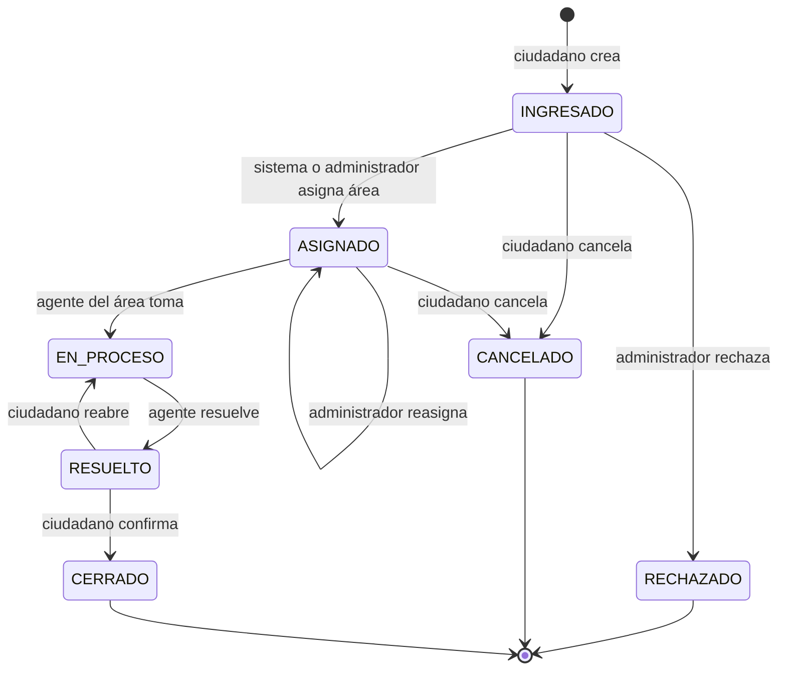
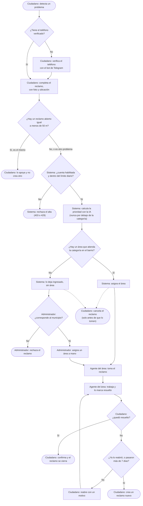
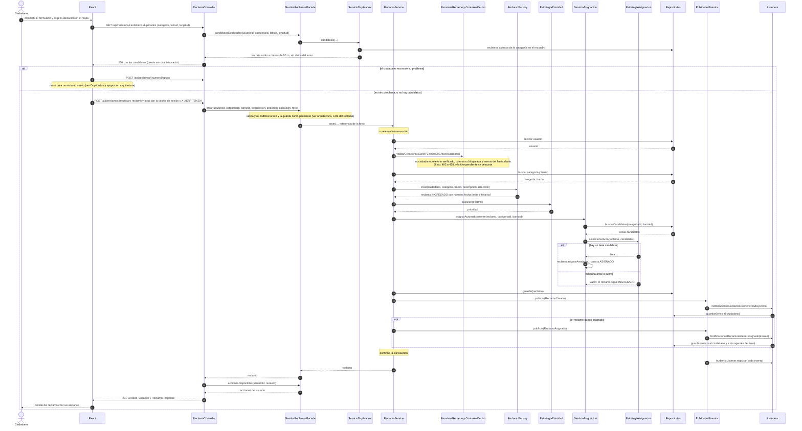
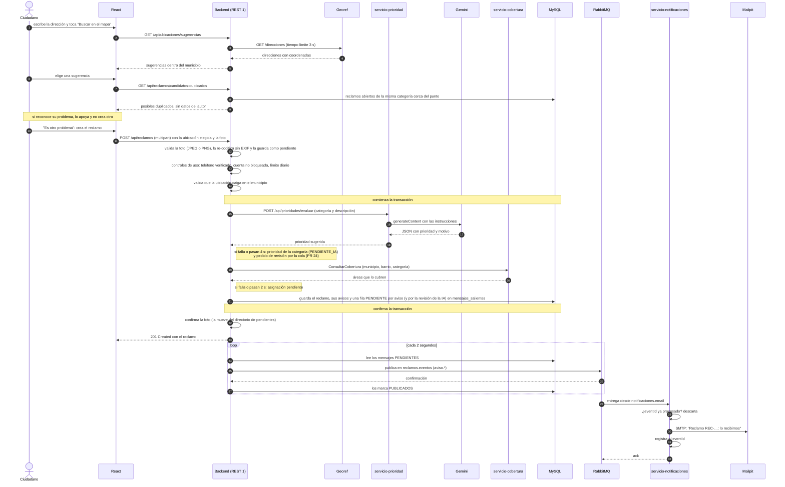
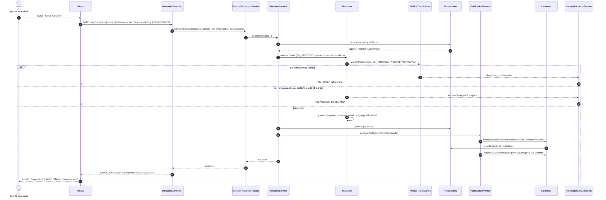
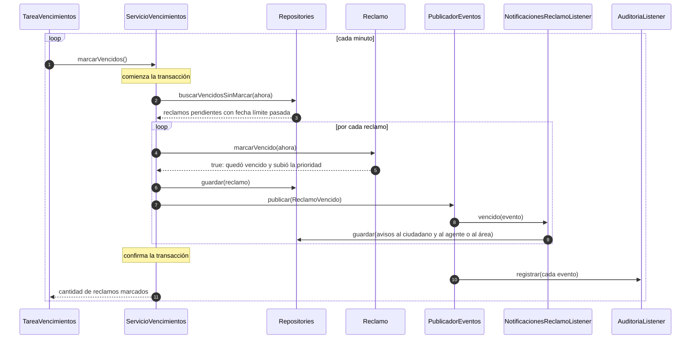

# Proceso de negocio y secuencias

## Ciclo de vida del reclamo

Las transiciones y los roles están definidos en un único lugar: `PoliticaTransiciones`.

Una transición que no está en el diagrama responde `409`. Una que está, pedida por un rol que no
corresponde o sobre un reclamo ajeno, responde `403`.

`RESUELTO → EN_PROCESO` (reabrir) tiene una regla más, en `PoliticaReapertura`: se permite **una vez**,
con un motivo, y **dentro de los 7 días** de la resolución. Después la acción ya no se ofrece; si el problema
sigue, el ciudadano puede crear un reclamo nuevo.

El vencimiento no es un estado. Un reclamo `INGRESADO`, `ASIGNADO` o `EN_PROCESO` que pasa su fecha
límite queda marcado como vencido y sube un nivel de prioridad, sin cambiar de estado.

## Proceso de negocio

Diagrama simplificado (BPMN simplificado como diagrama de flujo). Cada paso indica quién lo ejecuta.

- **Avisos:** el ciudadano recibe un aviso en cada paso, en la aplicación y por correo, y el área, cuando le
  asignan un reclamo.
- **Vencimiento:** no es un paso. Un reclamo pendiente que pasa su fecha límite queda marcado como vencido,
  sube un nivel de prioridad y se avisa, sin cambiar de estado.

## Secuencia: creación de un reclamo

Intervienen los cinco patrones: Facade (pasos 3 y 10), Factory (17), Strategy (19 y 24), Repository (5,
12, 15 y 28) y Observer (29 a 35). Antes del alta, los controles de uso (paso 14) son una Chain of
Responsibility: ver [patrones](patrones.md#chain-of-responsibility-propia-controles-de-uso).

## Secuencia: el alta y sus cinco integraciones

La secuencia anterior muestra las clases del backend. Esta muestra los procesos, tal como corre en la demo
(`docker compose up`): el mismo reclamo pasa por Georef, la IA, el servicio SOAP y RabbitMQ hasta llegar como
correo. La sexta integración, Telegram, no está en el alta: se usa antes, una sola vez, para verificar el
teléfono (ver [Teléfono verificado con Telegram](arquitectura.md#teléfono-verificado-con-telegram-segunda-api-externa)). Cada llamada externa tiene su respaldo; el detalle está en la [matriz de fallos](demo.md#matriz-de-fallos).

Georef se consulta antes del alta, cuando el ciudadano busca; el alta solo valida la sugerencia que eligió. La
IA y el SOAP corren dentro de la transacción: en el peor caso el alta espera unos 8 segundos (6 de la IA y 2 del
SOAP). La publicación en RabbitMQ y el correo pasan después de responder: el ciudadano no los espera.

## Secuencia: cambio de estado

El ejemplo es un agente que toma un reclamo. Las demás transiciones recorren el mismo camino.

Cuando el destino es `RESUELTO`, el servicio publica además `ReclamoResuelto`, y el aviso al
ciudadano sale de ese evento.

La asignación manual usa `PATCH /api/reclamos/{numero}/asignacion`: recorre el mismo camino, llama a
`Reclamo.asignarArea` y publica `ReclamoAsignado`.

## Secuencia: vencimiento de un reclamo

Es el único proceso que no arranca con una acción de un usuario: lo dispara una tarea programada.

Cada reclamo se marca una sola vez: en la siguiente ejecución ya no aparece entre los vencidos sin
marcar, así que no se repiten eventos ni avisos.
